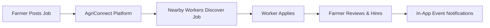
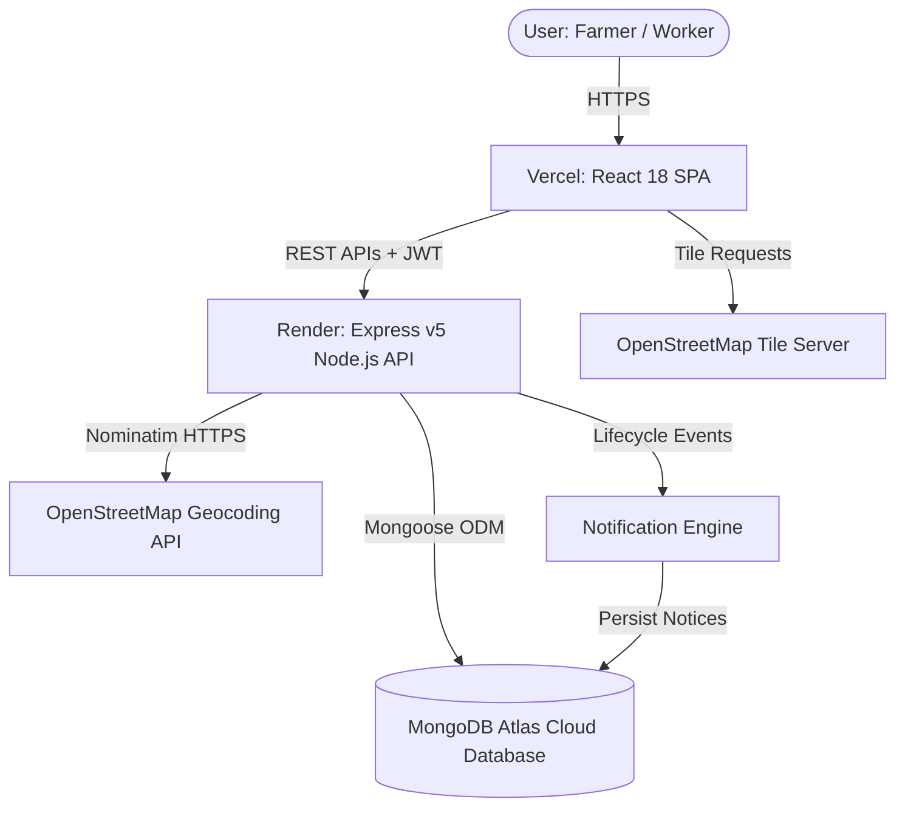

# 🌾 AgriConnect

**Connecting Farmers With the Right Workers — Empowering Indian Agriculture**

[](https://github.com/vishal-s-sollapure/AgriConnect)
[](https://github.com/vishal-s-sollapure/AgriConnect)
[](https://react.dev/)
[](https://nodejs.org/)
[](https://www.mongodb.com/)
[](https://opensource.org/licenses/ISC)
[](https://github.com/vishal-s-sollapure/AgriConnect)

AgriConnect is a dual-sided digital agricultural labor marketplace built to connect Indian farmers with local agricultural workers. By enabling farmers to list time-critical seasonal farming opportunities and allowing workers to discover local daily-wage work, apply with a single tap, and track their application progress, AgriConnect bridges the labor distribution gap in rural India. The platform eliminates commission-seeking middlemen, guarantees wage transparency, provides regional Indic language accessibility, and promotes equitable rural employment.

---

## 📌 Table of Contents

1. [Project Overview](#1-project-overview)
2. [Problem Statement](#2-problem-statement)
3. [Key Features](#3-key-features)
4. [Technology Stack](#4-technology-stack)
5. [Project Architecture](#5-project-architecture)
6. [Development Progress — All 9 Phases](#6-development-progress--all-9-phases)
7. [Phase 8 Manual Verification — Three Remaining Checks](#7-phase-8-manual-verification--three-remaining-checks)
8. [Installation and Local Setup](#8-installation-and-local-setup)
9. [Environment Variables](#9-environment-variables)
10. [API Documentation](#10-api-documentation)
11. [Database Setup](#11-database-setup)
12. [Testing Instructions](#12-testing-instructions)
13. [Project Screenshots](#13-project-screenshots)
14. [Future Scope](#14-future-scope)
15. [Deployment Status](#15-deployment-status)
16. [Contributing](#16-contributing)
17. [License](#17-license)

---

## 1. Project Overview

Agricultural operations across India—such as sowing, paddy transplanting, weeding, spraying, and crop harvesting—are strictly seasonal and weather-dependent. Delays in finding farm workers lead directly to crop degradation and devastating financial losses for smallholder farmers. Simultaneously, millions of rural agricultural laborers face unpredictable employment, relying on fragmented word-of-mouth networks or exploitative local labor intermediaries who charge commissions.

**AgriConnect** solves this dual-sided coordination bottleneck through an open, direct, and accessible digital platform:
- **For Farmers:** Fast job creation with clear crop specifications, work types, headcounts, daily wage rates, duration, and GPS farm location pinning, paired with real-time applicant management and capacity-enforced hiring.
- **For Agricultural Workers:** Transparent job discovery, location-based distance calculations, multi-parameter filtering, one-click job applications, and clear status tracking.
- **For Rural Inclusion:** Seven-language Indic localization, browser-native speech assistance, high-contrast accessible dialogs, and a responsive layout designed for entry-level 360px mobile devices.

---

## 2. Problem Statement

### Challenges for Farmers
- **Seasonal Labor Shortages:** Extreme difficulty securing reliable labor during narrow harvest and planting windows.
- **Time-Critical Risk:** Unharvested crops suffer quality degradation or spoilage when labor is unavailable on critical days.
- **Skill & Crop Alignment:** Lack of visibility into workers experienced with specific operations (e.g., cotton picking, wheat harvesting, paddy irrigation).
- **Wage Disparities:** Unstandardized wage expectations across neighboring villages.

### Challenges for Workers
- **Restricted Job Discovery:** Visibility is limited strictly to immediate personal acquaintances or village boundaries.
- **Income Instability:** Fluctuating and uncertain daily employment opportunities throughout the year.
- **Mobility & Distance Friction:** Absence of reliable distance estimates to farm locations before traveling.
- **Intermediary Exploitation:** Loss of earnings to informal contractors who deduct commissions from daily wages.

---

## 3. Key Features



### 1. Public Job Discovery & Search (`/jobs`)
- **Multi-Parameter Filtering:** Filter by crop type, work type, location (village, district, state), wage type (`daily`, `hourly`, `fixed`), wage range, and start date.
- **Debounced Search:** Real-time search with 380ms debouncing across titles, crops, descriptions, and locations with ReDoS-safe sanitization.
- **URL Parameter Sync:** Browser URL search parameters stay synchronized with active filters for shareable, bookmarkable searches.

### 2. Location-Based Matching & Interactive Map
- **Leaflet & OpenStreetMap Integration:** Zero-API-key interactive map with custom SVG markers, active job highlighting, and glassmorphism popups.
- **Dynamic View Modes:** Seamless toggling between **Split View** (side-by-side map and job list), **List View**, and **Map View**.
- **Haversine Distance Sorting:** Server-calculated great-circle distance (up to 100 km) for coordinate-backed jobs with formatted distance badges (`2.4 km away`).
- **GPS Location Picker:** Embedded interactive map for farmers to pin farm locations via click, draggable marker, or device GPS.
- **Nominatim Geocoding Proxy:** Secure server-side geocoding proxy (`GET /api/jobs/geocode`) for village/district address resolution.

### 3. Farmer Job & Applicant Management (`/farmer/jobs`)
- **Full Job Lifecycle:** Create, edit, close, reopen, and delete farm job listings with ownership validation.
- **Applicant Review (`/farmer/jobs/:id/applicants`):** Status tabs (`All`, `Pending`, `Accepted`, `Rejected`, `Withdrawn`) with applicant profile inspection.
- **Capacity Enforcement:** Mutex-backed concurrency safety ensuring accepted workers cannot exceed the required quota (`workersRequired`).
- **Privacy-Preserving Contact Disclosure:** Worker phone numbers remain masked until their application is accepted by the farmer.

### 4. Worker Application Management (`/worker/applications`)
- **Single-Tap Application:** Instant application submission with optional notes (up to 500 characters).
- **Duplicate Prevention:** Compound unique database index preventing duplicate submissions for the same job.
- **Self-Service Withdrawal:** Workers can withdraw pending applications before hiring decisions are finalized.
- **Real-Time Status Badges:** Server-synced state updates (`Pending Review`, `Accepted / Hired`, `Rejected`, `Withdrawn`).

### 5. Multilingual Voice & AI Assistance (`AIAssistantWidget.jsx`)
- **Seven Supported Languages:** English, Kannada, Hindi, Gujarati, Marathi, Tamil, and Telugu.
- **Voice Input & Synthesis:** Browser Web Speech API integration with text-input fallback for hands-free queries.
- **Deterministic AI Planning:** Local rule-based wage estimation, seasonal crop calendars, and compatibility scoring.

### 6. Event Notifications (`NotificationCenter.jsx`)
- **Lifecycle Events:** In-app event generation for applications (`new_application`, `application_accepted`, `application_rejected`, `application_withdrawn`) and jobs (`job_updated`, `job_closed`).
- **Recipient-Scoped APIs:** Dedicated endpoints for polling unread counts, reading, marking read, and deleting notices.
- **Accessible Bell Indicator:** Screen-reader accessible unread counter badge and interactive drawer.

---

## 4. Technology Stack

| Layer | Technology | Details / Purpose |
| :--- | :--- | :--- |
| **Frontend Framework** | React 18.2 | Single-page application architecture with functional components and hooks |
| **Build & Tooling** | Vite 5.4 | Fast ESM development server and Rollup production bundler |
| **Routing** | React Router v7 | Client-side routing with lazy-loaded code-split pages |
| **Styling & Design** | Pure CSS & Glassmorphism | Custom design system, responsive media queries, reduced-motion support |
| **Icons & Visuals** | Lucide React | High-contrast accessible SVG icons |
| **Mapping Engine** | Leaflet 1.9 & React-Leaflet | OpenStreetMap tiles, custom SVG DivIcons, draggable marker picker |
| **HTTP Client** | Axios 1.20 & Fetch API | REST API communication with automatic JWT Authorization interceptor |
| **Backend Runtime** | Node.js (v20+) | Event-driven server runtime |
| **Backend Framework** | Express v5.2 | RESTful API routing, middleware chaining, and error handling |
| **Database** | MongoDB | Document-oriented database for users, jobs, applications, notifications |
| **ODM** | Mongoose v9.11 | Schema enforcement, validation, indexing, and population |
| **Authentication** | JWT & bcryptjs | Stateless Bearer token verification and cryptographic password hashing |
| **Security & CORS** | CORS & dotenv | Strict origin validation, multi-domain support, environment segregation |

---

## 5. Project Architecture

### Monorepo Structure

```
AgriConnect/
├── package.json              # Root workspace management
├── render.yaml               # Render Infrastructure-as-Code blueprint
├── README.md                 # Primary documentation
└── AgriConnect/
    ├── package.json          # Root scripts
    ├── client/               # Frontend React Application
    │   ├── package.json
    │   ├── vite.config.js
    │   ├── vercel.json       # Vercel SPA rewrite configuration
    │   ├── .env.example      # Client environment template
    │   ├── index.html
    │   └── src/
    │       ├── components/   # Common, layout, map, and modal components
    │       ├── context/      # AuthContext, AgriContext, LanguageContext
    │       ├── hooks/        # useDialogAccessibility
    │       ├── i18n/         # translations.js, phase8Regional.js, formatters.js
    │       ├── pages/        # Landing, Auth, Farmer, Worker portals
    │       ├── services/     # api.js, jobService.js, applicationService.js, notificationService.js
    │       └── utils/        # Geolocation, Haversine, AI matching
    └── server/               # Backend Express Application
        ├── package.json
        ├── server.js         # Entry point, CORS, startup validation
        ├── .env.example      # Server environment template
        ├── config/           # Database connection (db.js)
        ├── controllers/      # auth, user, job, application, notification, ai
        ├── middleware/       # JWT authMiddleware, role authorization
        ├── models/           # User, Job, Application, Notification
        ├── routes/           # auth, user, job, application, notification, ai
        ├── services/         # notificationService, aiService
        ├── tests/            # Automated test suites (Phases 1–7 and 9)
        └── utils/            # Geolocation, Haversine formulas
```

### Architecture Diagram



---

## 6. Development Progress — All 9 Phases

All 9 planned development phases have been implemented in the codebase and pushed to GitHub. Automated test suites validate business logic, authorization, data schemas, and translation key coverage.

```
PHASE 1 ✅ Landing Page & Design System
        ↓
PHASE 2 ✅ Authentication & Role-Based Profiles
        ↓
PHASE 3 ✅ Farmer Job Posting & Management
        ↓
PHASE 4 ✅ Worker Job Discovery & Applications
        ↓
PHASE 5 ✅ Farmer Applicant Management & Hiring
        ↓
PHASE 6 ✅ Location-Based Job Matching & Interactive Mapping
        ↓
PHASE 7 ✅ Voice, Multilingual & Seasonal Planning
        ↓
PHASE 8 🟡 Regional Localization & Rural Accessibility (Implementation Complete; Manual Sign-Off Pending)
        ↓
PHASE 9 ✅ Notifications & Event Messaging
```

### Phase Completion Status Matrix

| Phase | Title | Implementation | Automated Tests | Manual Sign-Off | Status |
| :---: | :--- | :---: | :---: | :---: | :---: |
| **Phase 1** | Landing Page & Design System | Completed | Passed | Verified | **Completed** |
| **Phase 2** | Authentication & Profiles | Completed | Passed | Verified | **Completed** |
| **Phase 3** | Farmer Job Posting | Completed | Passed | Verified | **Completed** |
| **Phase 4** | Worker Job Discovery & Applications | Completed | Passed | Verified | **Completed** |
| **Phase 5** | Farmer Applicant Management & Hiring | Completed | Passed | Verified | **Completed** |
| **Phase 6** | Location-Based Job Matching & Maps | Completed | Passed | Verified | **Completed** |
| **Phase 7** | Voice Assistance & Seasonal Planning | Completed | Passed | Verified | **Completed** |
| **Phase 8** | Regional Localization & Accessibility | Completed | Passed | **Pending** | **Implementation Complete; Manual Sign-Off Pending** |
| **Phase 9** | Notifications & Event Messaging | Completed | Passed | Verified | **Completed** |

---

## 7. Phase 8 Manual Verification — Three Remaining Checks

While Phase 8 code implementation and automated dictionary parity tests are complete (301 keys verified per language with 0 missing translations), **final sign-off is pending on three real-world manual verification activities**.

> [!IMPORTANT]
> **Audit Rule:** These three checks require human and assistive-technology evaluation in real environments. They must not be marked as passed until verified with evidence.

### Check 1: Native Indic Linguistic & Dialectal Review
- **Languages:** Gujarati (`gu`), Marathi (`mr`), Tamil (`ta`), Telugu (`te`), plus spot-checks for Kannada (`kn`) and Hindi (`hi`).
- **Audit Requirement:** Native speakers familiar with regional agricultural practices must review domain terms on live screens:
  - Farm operations (e.g., harvesting, sowing, weeding, spraying, tilling).
  - Compensation phrasing (daily wage, hourly rate, fixed lump sum).
  - Dynamic sentence interpolation (ensuring variable injection like `{{jobTitle}}` or `{{count}}` conforms to postpositional grammar).
- **Status:** Standardized review template created; human native-speaker review is **pending**.

### Check 2: Screen-Reader Accessibility Audit
- **Assistive Technologies:** NVDA and Windows Narrator on desktop (Windows); Android TalkBack on mobile.
- **Audit Requirement:**
  - Verify modal dialogs announce `dialog` role and title upon opening (`role="dialog"`, `aria-modal="true"`, `aria-labelledby`).
  - Verify dynamic form validation errors announce immediately without manual navigation via `role="alert"` and `aria-live="assertive"`.
  - Verify the notification bell announces unread counts with full context (`aria-label="Notifications, 2 unread"`).
- **Status:** Code semantically instrumented; screen-reader acoustic/transcript review is **pending**.

### Check 3: Keyboard Navigation & 360px Mobile Layout Audit
- **Browsers:** Google Chrome, Microsoft Edge, Mozilla Firefox.
- **Target Dimensions:** 360 $\times$ 740 px CSS viewport (budget Indian smartphones).
- **Audit Requirement:**
  - Verify full keyboard navigability (`Tab`, `Shift + Tab`, `Enter`, `Escape`) with visible high-contrast focus rings (`outline: 3px solid #a3e635`).
  - Verify dialog focus trapping (focus stays inside modals and returns to triggering buttons upon `Escape`).
  - Execute horizontal overflow detection (`TEST-MOB-01`) on `/jobs` and `/farmer/jobs/:id/applicants` in Tamil and Telugu to confirm zero horizontal scroll (`document.documentElement.scrollWidth === 360`).
  - Inspect Indic vowel ascenders and conjunct descenders (`TEST-MOB-02`) on badges and buttons to verify zero character clipping.
- **Status:** Testing procedures documented; multi-browser manual walkthrough is **pending**.

---

## 8. Installation and Local Setup

### Prerequisites
- **Node.js:** v20.0.0 or higher
- **npm:** v10.0.0 or higher
- **MongoDB:** Local MongoDB Community Server running on `mongodb://localhost:27017` OR a free MongoDB Atlas cloud cluster URI
- **Git:** Installed and configured

### Step-by-Step Local Setup

1. **Clone the Repository:**
   ```bash
   git clone https://github.com/vishal-s-sollapure/AgriConnect.git
   cd AgriConnect
   ```

2. **Install Dependencies:**
   ```bash
   # Install all dependencies for root, client, and server
   npm run install:all
   ```

3. **Configure Environment Variables:**
   - Server: Copy `AgriConnect/server/.env.example` to `AgriConnect/server/.env` and update values if needed.
   - Client: Defaults to `http://localhost:5000/api` automatically; no local `.env` required.

4. **Start Development Servers:**
   ```bash
   # Start both backend and frontend concurrently
   npm run dev
   ```
   - Frontend SPA will be accessible at: `http://localhost:5173`
   - Backend API will be accessible at: `http://localhost:5000`

---

## 9. Environment Variables

### Backend Server (`AgriConnect/server/.env`)

| Variable Name | Required | Default (Local) | Production Example | Description |
| :--- | :---: | :--- | :--- | :--- |
| `PORT` | Optional | `5000` | `5000` (assigned by Render) | Port on which Express server listens |
| `NODE_ENV` | Required | `development` | `production` | Execution environment mode |
| `MONGODB_URI` | Required | `mongodb://localhost:27017/agriconnect` | `mongodb+srv://<user>:<pwd>@cluster.mongodb.net/agriconnect` | MongoDB connection string |
| `JWT_SECRET` | Required | (dev string) | Strong random string (min 32 chars) | Cryptographic key for signing JWT tokens |
| `CLIENT_URL` | Required in Prod | `http://localhost:5173` | `https://your-app.vercel.app` | Allowed CORS origins (comma-separated for multiples) |

### Frontend Client (`AgriConnect/client/.env`)

| Variable Name | Required | Default (Local) | Production Example | Description |
| :--- | :---: | :--- | :--- | :--- |
| `VITE_API_BASE_URL` | Production | `http://localhost:5000/api` | `https://agriconnect-api.onrender.com/api` | Base URL of the backend API with `/api` suffix |

---

## 10. API Documentation

All API routes are mounted under the `/api` prefix (except the root health-check). Protected routes require an `Authorization: Bearer <jwt_token>` header.

### 1. System Health
| Method | Endpoint | Auth Required | Description |
| :--- | :--- | :---: | :--- |
| `GET` | `/` | No | Basic server health check (`{ message: "AgriConnect API is running..." }`) |

### 2. Authentication (`/api/auth`)
| Method | Endpoint | Auth Required | Request Body / Parameters | Description |
| :--- | :--- | :---: | :--- | :--- |
| `POST` | `/api/auth/register` | No | `{ name, email, phone, password, role, location, ... }` | Register new farmer or worker |
| `POST` | `/api/auth/login` | No | `{ email, password, role }` | Authenticate user & receive JWT token |
| `GET` | `/api/auth/me` | Yes | Bearer Token | Fetch current authenticated user record |
| `POST` | `/api/auth/logout` | No | None | Logout signal |

### 3. User Profiles (`/api/users`)
| Method | Endpoint | Auth / Role | Description |
| :--- | :--- | :---: | :--- |
| `GET` | `/api/users/profile` | Yes (Any) | Retrieve logged-in user profile |
| `PUT` | `/api/users/profile` | Yes (Any) | Update profile details (phone, skills, location, etc.) |
| `GET` | `/api/users/workers/:id` | Yes (Farmer) | Retrieve safe worker profile for hiring evaluation |

### 4. Job Management & Discovery (`/api/jobs`)
| Method | Endpoint | Auth / Role | Description |
| :--- | :--- | :---: | :--- |
| `GET` | `/api/jobs` | No | Public job search with filters (`crop`, `location`, `wageType`, `minWage`, `maxWage`, `startDate`, `page`, `limit`) |
| `GET` | `/api/jobs/nearby` | No | Distance-sorted job search (`lat`, `lng`, `radiusKm`) |
| `GET` | `/api/jobs/geocode` | No | OpenStreetMap Nominatim proxy (`q`) with caching |
| `GET` | `/api/jobs/:id` | Optional | Retrieve job details (includes worker application state if authenticated) |
| `POST` | `/api/jobs` | Yes (Farmer) | Create a new farm job listing with specifications and coordinates |
| `GET` | `/api/jobs/my-jobs` | Yes (Farmer) | List all jobs created by the authenticated farmer |
| `PUT` | `/api/jobs/:id` | Yes (Owner Farmer) | Update job specifications and farm coordinates |
| `PATCH` | `/api/jobs/:id/status` | Yes (Owner Farmer) | Change job lifecycle status (`open`, `in_progress`, `completed`, `cancelled`) |
| `DELETE` | `/api/jobs/:id` | Yes (Owner Farmer) | Delete a farm job listing |
| `POST` | `/api/jobs/:id/apply` | Yes (Worker) | Submit a job application with optional notes |
| `GET` | `/api/jobs/:id/applications` | Yes (Owner Farmer) | List all applicants for a specific job with status filters |
| `GET` | `/api/jobs/:id/hiring-summary` | Yes (Owner Farmer) | Live capacity stats (total, pending, accepted, remaining vacancies) |

### 5. Worker Applications (`/api/applications`)
| Method | Endpoint | Auth / Role | Description |
| :--- | :--- | :---: | :--- |
| `GET` | `/api/applications/my-applications` | Yes (Worker) | Fetch all applications submitted by the worker |
| `PATCH` | `/api/applications/:id/withdraw` | Yes (Worker) | Withdraw a pending job application |
| `PATCH` | `/api/applications/:id/status` | Yes (Owner Farmer) | Accept or reject an application with capacity enforcement |

### 6. Notifications (`/api/notifications`)
| Method | Endpoint | Auth Required | Description |
| :--- | :--- | :---: | :--- |
| `GET` | `/api/notifications/unread-count` | Yes | Get the count of unread notifications |
| `GET` | `/api/notifications` | Yes | Fetch paginated notification history for the user |
| `PATCH` | `/api/notifications/:id/read` | Yes | Mark a single notification as read |
| `PATCH` | `/api/notifications/read-all` | Yes | Mark all user notifications as read |
| `DELETE` | `/api/notifications/:id` | Yes | Delete a notification record |

### 7. AI & Planning Services (`/api/ai`)
| Method | Endpoint | Auth Required | Description |
| :--- | :--- | :---: | :--- |
| `POST` | `/api/ai/recommendations` | No | Calculate job compatibility scores using skills and proximity |
| `POST` | `/api/ai/voice-assistant` | No | Parse Indic speech transcripts into structured search intents |
| `POST` | `/api/ai/wage-prediction` | No | Deterministic wage benchmarks based on crop, operation, and duration |
| `GET` | `/api/ai/demand-forecast` | No | Seasonal regional labor demand estimates by crop calendar |

---

## 11. Database Setup

AgriConnect uses **MongoDB** with Mongoose schemas.

### Core Collections & Models
1. **`users` (`User.js`):** Stores user identity, role (`farmer` / `worker`), encrypted password hashes (bcrypt), contact details, and optional profile fields (farm size, skills, experience).
2. **`jobs` (`Job.js`):** Stores job listings with crop details, operation type, headcount required, daily wage, duration, verified coordinates (`latitude`, `longitude`), and lifecycle status.
3. **`applications` (`Application.js`):** Tracks worker submissions with notes, status (`pending`, `accepted`, `rejected`, `withdrawn`), and timestamps.
   - *Compound Unique Index:* `{ job: 1, worker: 1 }` prevents duplicate applications.
4. **`notifications` (`Notification.js`):** In-app user notifications for application status changes and job updates.
   - *Indexes:* `{ recipient: 1, createdAt: -1 }`, `{ recipient: 1, readAt: 1 }`, and unique deduplication index on `{ dedupeKey: 1 }`.

### MongoDB Atlas Setup (Production)
1. Create a free M0 cluster on [MongoDB Atlas](https://www.mongodb.com/atlas).
2. Create a Database User with read/write permissions.
3. Under **Network Access**, add `0.0.0.0/0` (Allow Access from Anywhere) to permit connections from Render's dynamic outbound IP addresses.
4. Copy the connection string (format: `mongodb+srv://<username>:<password>@cluster0.xxxxx.mongodb.net/agriconnect?retryWrites=true&w=majority`).
5. Set this string as the `MONGODB_URI` environment variable in Render.

---

## 12. Testing Instructions

### Client Localization & Dictionary Integrity Tests
Validates all 301 translation keys and placeholder parity across all 7 supported Indic languages:
```bash
npm run test:i18n --prefix AgriConnect/client
```

### Client Production Build
Validates Vite compilation, Rollup code splitting, and asset bundling:
```bash
npm run build --prefix AgriConnect/client
```

### Server Integration & Unit Tests
To run the automated server test suites against a running MongoDB instance:
```bash
# Run all server feature and regression test suites
npm test --prefix AgriConnect/server

# Run specific phase test suites
npm run test:phase1 --prefix AgriConnect/server      # Health check, AI routing, exports
npm run test:phase2 --prefix AgriConnect/server      # Auth, bcrypt, JWT, roles
npm run test:phase3 --prefix AgriConnect/server      # Farmer job CRUD & metrics
npm run test:phase4 --prefix AgriConnect/server      # Worker discovery & applications
npm run test:phase5 --prefix AgriConnect/server      # Applicant review, capacity, privacy
npm run test:phase6 --prefix AgriConnect/server      # Location matching & Haversine distance
npm run test:phase6-7 --prefix AgriConnect/server    # AI match scores & seasonal forecasts
npm run test:phase9:unit --prefix AgriConnect/server # Notification schema, event generation
npm run test:phase9 --prefix AgriConnect/server      # Notification integration lifecycle
```

---

## 13. Project Screenshots

> Visual capture assets and walkthrough screenshots are scheduled to be captured and cataloged during the **Phase 8 live browser sign-off** and **production staging rollout**. In accordance with documentation integrity standards, no unverified mockups or fabricated screenshots are included.

Once captured during staging, real screenshots of the following primary views will be placed in `docs/screenshots/`:
- `landing-page-hero.png`: Dual-role hero with quick registration.
- `job-discovery-map-split.png`: Split view showing Leaflet interactive pins alongside job cards.
- `farmer-applicant-management.png`: Capacity progress bar and hiring decision modals.
- `worker-application-tracker.png`: Worker status cards with withdrawal modal.
- `multilingual-language-switch.png`: Regional language selector and localized UI in Tamil / Telugu.

---

## 14. Future Scope

While all 9 foundational phases are complete, future engineering phases can introduce:
- **Direct SMS & WhatsApp Alerts:** Twilio or Gupshup integration for workers without continuous smartphone data connectivity.
- **Offline-First PWA:** Service worker caching for job inspection in remote rural fields with intermittent connectivity.
- **Machine Learning Pricing Engine:** Dynamic wage guidance trained on regional mandi transaction volume and seasonal weather patterns.
- **UPI Escrow & Instant Payouts:** Milestone-based daily wage escrow ensuring guaranteed same-day payment upon job completion.
- **Aadhaar-Based Identity Verification:** Verified farmer landholding records and worker credential badges.

---

## 15. Deployment Status

- **Development Status:** All 9 development phases implemented.
- **Repository Status:** Code committed and pushed to GitHub main branch.
- **Automated Tests:** Client dictionary tests and server integration test suites implemented and reported as passed.
- **Production Deployment:** **Pending** (Deployment Architecture prepared below).

### Target Production Architecture
- **Frontend SPA:** [Vercel](https://vercel.com/)
- **Backend API:** [Render](https://render.com/)
- **Database:** [MongoDB Atlas](https://www.mongodb.com/atlas)
- **Source Control:** [GitHub Repository](https://github.com/vishal-s-sollapure/AgriConnect)

### Step-by-Step Deployment Guide

#### 1. Database Deployment (MongoDB Atlas)
1. Set up an M0 cluster on MongoDB Atlas.
2. Whitelist `0.0.0.0/0` under Network Access.
3. Obtain connection URI: `mongodb+srv://<user>:<password>@cluster0.mongodb.net/agriconnect?retryWrites=true&w=majority`.

#### 2. Backend Deployment (Render)
1. In Render, select **New > Blueprint** and connect `vishal-s-sollapure/AgriConnect`.
   *(Render will automatically detect `render.yaml` at the root).*
2. Alternatively, select **New > Web Service**:
   - **Root Directory:** `AgriConnect/server`
   - **Build Command:** `npm ci`
   - **Start Command:** `npm start`
   - **Health Check Path:** `/`
3. Configure Environment Variables in Render:
   - `NODE_ENV`: `production`
   - `PORT`: `5000` (or Render default)
   - `MONGODB_URI`: `<your-mongodb-atlas-uri>`
   - `JWT_SECRET`: `<random-secret-at-least-32-chars>`
   - `CLIENT_URL`: `https://your-agriconnect-frontend.vercel.app`
4. Deploy the service and note your Render API URL (e.g., `https://agriconnect-api.onrender.com`).

#### 3. Frontend Deployment (Vercel)
1. In Vercel, select **Add New > Project** and import `vishal-s-sollapure/AgriConnect`.
2. Configure Project Settings:
   - **Framework Preset:** `Vite`
   - **Root Directory:** Click Edit and select `AgriConnect/client`
   - **Build Command:** `npm run build`
   - **Output Directory:** `dist`
3. Add Environment Variable:
   - `VITE_API_BASE_URL`: `https://agriconnect-api.onrender.com/api` *(your Render URL + `/api`)*
4. Deploy. Vercel automatically applies SPA rewrites from `AgriConnect/client/vercel.json`.
5. Copy your live Vercel domain (e.g., `https://agriconnect.vercel.app`) and update the `CLIENT_URL` variable on Render to ensure CORS authorization.

---

## 16. Contributing

1. Fork the repository: `https://github.com/vishal-s-sollapure/AgriConnect`.
2. Create a feature branch: `git checkout -b feature/rural-enhancement`.
3. Commit your changes: `git commit -m 'feat: add rural enhancement'`.
4. Run validation checks: `npm run test:i18n --prefix AgriConnect/client`.
5. Push to the branch: `git push origin feature/rural-enhancement`.
6. Open a Pull Request detailing the changes and evidence of test verification.

---

## 17. License

This project is licensed under the **ISC License** as declared in the project configuration:

```
ISC License

Copyright (c) 2026 Vishal S Sollapure

Permission to use, copy, modify, and/or distribute this software for any
purpose with or without fee is hereby granted, provided that the above
copyright notice and this permission notice appear in all copies.

THE SOFTWARE IS PROVIDED "AS IS" AND THE AUTHOR DISCLAIMS ALL WARRANTIES
WITH REGARD TO THIS SOFTWARE INCLUDING ALL IMPLIED WARRANTIES OF
MERCHANTABILITY AND FITNESS. IN NO EVENT SHALL THE AUTHOR BE LIABLE FOR
ANY SPECIAL, DIRECT, INDIRECT, OR CONSEQUENTIAL DAMAGES OR ANY DAMAGES
WHATSOEVER RESULTING FROM LOSS OF USE, DATA OR PROFITS, WHETHER IN AN
ACTION OF CONTRACT, NEGLIGENCE OR OTHER TORTIOUS ACTION, ARISING OUT OF
OR IN CONNECTION WITH THE USE OR PERFORMANCE OF THIS SOFTWARE.
```

---

*Author: **Vishal S Sollapure** | Repository: [AgriConnect](https://github.com/vishal-s-sollapure/AgriConnect)*
