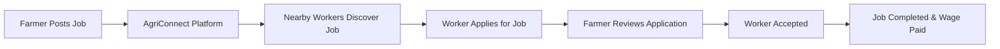
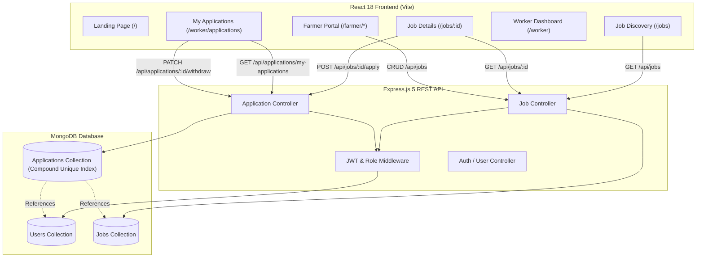

# 🌾 AgriConnect

**Connecting Farmers With the Right Workers**

[](https://github.com/vishal-s-sollapure/AgriConnect)
[](https://react.dev/)
[](https://vitejs.dev/)
[](https://nodejs.org/)
[](https://expressjs.com/)
[](https://www.mongodb.com/)
[](https://opensource.org/licenses/ISC)

AgriConnect is a technology platform designed to directly connect farmers with local agricultural workers across India. By enabling farmers to post time-critical farm jobs and allowing workers to discover nearby daily-wage opportunities, apply with a single tap, and track their application progress, AgriConnect bridges the gap in rural agricultural labor management. The platform eliminates exploitative middlemen, guarantees transparent wages, and empowers farming communities through accessible digital technology.

---

## 📌 Table of Contents

- [About the Project](#-about-the-project)
- [Problem Statement](#-problem-statement)
- [Our Solution](#-our-solution)
- [Features](#-features)
  - [Currently Implemented (Phases 1–9)](#-currently-implemented-phases-19)
- [Tech Stack](#-tech-stack)
- [API Reference](#-api-reference)
- [Architecture](#-architecture)
- [Project Structure](#-project-structure)
- [Getting Started](#-getting-started)
  - [Prerequisites](#prerequisites)
  - [Install & Run](#install--run)
- [Environment Variables](#-environment-variables)
- [Usage & User Workflows](#-usage--user-workflows)
  - [Farmer Workflow](#1-farmer-workflow)
  - [Worker Workflow](#2-worker-workflow)
- [Roadmap](#-roadmap)
- [Security & Data Integrity](#-security--data-integrity)
- [Testing & Quality Assurance](#-testing--quality-assurance)
- [Social Impact](#-social-impact)
- [Contributing](#-contributing)
- [License](#-license)
- [Author](#-author)

---

## 🎯 About the Project

**AgriConnect** is purpose-built for the agricultural ecosystem in India. Farming operations such as crop harvesting, sowing, weeding, and paddy preparation are highly seasonal and time-critical. Delays in obtaining workers can lead to devastating crop losses for farmers, while workers frequently struggle to find consistent, nearby employment with fair daily wages.

AgriConnect provides a dual-sided marketplace tailored for both **Farmers** and **Agricultural Workers**:
- **For Farmers:** Fast, straightforward job creation specifying crop type, worker requirements, location, daily wage rate, and duration, alongside real-time application tracking.
- **For Workers:** Instant discovery of open agricultural opportunities, transparent wage details, crop requirements, one-click job applications, and status tracking.
- **Long-term Vision:** To create an intelligent, voice-first, multilingual agricultural labor network that uses AI-driven location matching, wage estimation, and labor demand prediction to uplift rural livelihoods.

---

## 🚜 Problem Statement

Agricultural labor allocation in India relies heavily on informal, fragmented channels and word-of-mouth recommendations, creating inefficiencies for both sides:

### Farmers
- **Seasonal Labor Shortages:** Difficulty securing farm hands during peak harvesting or planting windows.
- **Time-Sensitive Risk:** Crop damage or quality degradation when harvesting is delayed due to worker unavailability.
- **Skill Alignment:** Difficulty finding workers experienced with specific crops (e.g., wheat bundling, cotton picking, paddy channel irrigation).
- **Lack of Transparency:** Variable wage expectations and labor availability uncertainties.

### Workers
- **Limited Job Visibility:** Inability to find farm work opportunities outside their immediate village or personal network.
- **Inconsistent Employment:** Unpredictable daily wage income due to lack of a centralized platform.
- **Distance & Mobility Constraints:** Difficulty finding work close to their place of residence.
- **Exploitative Middlemen:** Loss of income to unorganized agents and brokers who charge commissions.

---

## 💡 Our Solution

AgriConnect creates a direct, location-aware digital marketplace connecting farmers directly with nearby workers without intermediaries.

### Workflow Overview



1. **Job Posting:** Farmers post farm job listings with crop specifications, daily wage rate, and worker headcounts.
2. **Job Discovery:** Workers view open jobs with multi-parameter filtering (crop, work type, location, wage range, start date).
3. **Application:** Workers submit job applications directly through the platform with optional notes.
4. **Tracking & Management:** Workers track status (`pending`, `accepted`, `rejected`, `withdrawn`) and can withdraw pending applications.
5. **Direct Connection:** Accepted workers connect directly with farmers to complete agricultural tasks.

---

## ✨ Features

### ✅ Currently Implemented (Phases 1–9)

The codebase implements Phases 1–5 (landing page, authentication, job management, worker discovery, and farmer hiring), Phase 6 (location-based matching and interactive mapping), Phase 7 (multilingual voice assistance and seasonal planning estimates), Phase 8 (multilingual UI completion, regional localization, and accessibility refinements), and Phase 9 (notification-driven user engagement and notification management):

#### Phase 8 — Completion Sweep: Regional Localization & Accessibility
- **Seven-Language UI Coverage:** Supported locales include English, Kannada, Hindi, Gujarati, Marathi, Tamil, and Telugu, with translation keys validated across the client UI.
- **Regional Translation Completion:** Missing and inconsistent strings across job creation, job details, applicant management, and application tracking flows were completed for the regional dictionaries.
- **Accessibility Improvements:** Dialog focus management, Escape-to-close handling, screen-reader labels, and focus restoration were added for key farmer/worker workflows.
- **Validation Automation:** Coverage checks verify translation presence, non-empty string values, and placeholder compatibility across all supported languages.

#### Phase 9 — Notifications & Event Messaging
- **Notification System:** Application lifecycle events (new application, accepted, rejected, withdrawn, job updates, and closure) are emitted and persisted in the backend notification model.
- **Notification APIs:** Routes expose notification retrieval, unread count, mark-read, and delete flows with validation and authentication checks.
- **Deduplication & Safety:** Notifications include dedupe keys, schema indexes, and metadata constraints to avoid duplicate or privacy-leaking events.
- **Unit Validation:** Phase 9 notification tests validate schema, indexes, event metadata, validation rules, and route authorization behavior.

#### 1. Location-Based Job Matching & Interactive Map (`/jobs`) — Phase 6
- **Interactive Leaflet Map (`JobMap.jsx`):** High-performance interactive map utilizing OpenStreetMap tiles with zero paid API keys. Renders custom SVG DivIcons for pinned jobs with custom crop badges and active markers.
- **Dynamic View Modes:** Workers can toggle between **Split View** (side-by-side interactive map and job list), **List Only**, and **Map Only**.
- **Interactive Popups & Sync:** Clicking any map pin opens a rich glassmorphism popup displaying the crop, job title, wage rate, location, and a direct link to view full specifications. Selecting a map pin highlights the corresponding job card.
- **Precise Haversine Distance Calculation:** Server calculates exact great-circle spherical distance in kilometers for jobs with verified coordinates, displayed as clean distance badges (`2.4 km away`).
- **No Fabricated Distances:** Distances are never calculated or invented for jobs lacking coordinates. Text-only jobs remain discoverable via text search without showing false distance badges.
- **Nearby Jobs API (`GET /api/jobs/nearby`):** Dedicated endpoint validating latitude, longitude, and radius (capped at 100 km), returning open jobs sorted by ascending distance.
- **Explicit Worker GPS Permission:** "Use My Location" triggers browser geolocation strictly upon explicit worker button click with clear explanation, error recovery (permission denial, timeouts, unsupported devices), and zero coordinate persistence in the database.
- **Farmer Location Picker Map (`LocationPickerMap.jsx`):** Embedded map in job creation (`/farmer/jobs/new`) and editing (`/farmer/jobs/:id/edit`) enabling farmers to pin farm locations via map click, draggable marker, or device GPS.
- **Nominatim Geocoding Proxy (`GET /api/jobs/geocode`):** Secure server-side geocoding proxy converting human-readable farm addresses to coordinates with caching, user-agent compliance, and graceful error handling.
- **Owner-Protected Coordinate Updates:** Only the verified job owner can edit or clear coordinates. Coordinates can be reset to `null` while preserving the text-based farm location.

#### 2. Farmer Applicant Management & Hiring (`/farmer/jobs/:id/applicants`) — Phase 5
- **Dedicated Applicant Review View:** Accessible exclusively to the job-owning farmer, displaying job specifications, status badges, and hiring progress.
- **Hiring Summary & Progress Bar:** Displays real database-aggregated metrics for total applications, pending review, accepted/hired count, remaining vacancies, rejected, and withdrawn counts with a dynamic percentage progress bar.
- **Capacity Enforcement & Staffing Alerts:** Enforces that accepted workers cannot exceed `workersRequired`. Displays a prominent notification when a job is fully staffed and disables further acceptances.
- **Concurrency-Safe Hiring:** Employs an in-process per-job mutex and atomic `Application.findOneAndUpdate` to guarantee capacity limits are strictly honored even under parallel acceptance requests.
- **Safe Worker Profile Modal:** Authenticated farmers can inspect full worker credentials (skills, agricultural experience, availability, preferred radius, platform registration date, and history of applications under this farmer) without exposing private emails, password hashes, or sensitive fields.
- **Privacy-Preserving Contact Disclosure:** Worker phone numbers remain strictly masked and confidential until the farmer accepts their application, at which point direct phone contact is revealed for work coordination.
- **Interactive Hiring Decisions:** Single-click "Accept Worker" or "Reject Application" buttons with confirmation modal dialogs preventing accidental decisions and duplicate submissions during in-flight requests.
- **Status Filter Tabs:** Filter applicant cards by `All`, `Pending`, `Accepted`, `Rejected`, and `Withdrawn` with live counts.

#### 3. Farmer Dashboard & Job Cards Integration — Phase 5
- **Real Database-Aggregated Stats:** Live metrics on the farmer dashboard for Total Posted Jobs, Open Jobs, Total Applications Received, Pending Review, and Accepted Workers.
- **Per-Job Applicant Indicators:** Every job card in the dashboard and "My Jobs" (`/farmer/jobs`) shows live applicant count badges (`X Applicants`, `Y pending`, `Z/W hired`).
- **Direct Navigation Links:** One-click "Manage Applicants" button on each job card and in the job details action bar.

#### 4. Worker Application Status Reflection — Phase 5
- **Server-Synced Tracking:** Workers' "My Applications" page reflects real-time server statuses (`Accepted: Selected for Job`, `Rejected: Not Selected`, `Withdrawn by Worker`, `Pending: Awaiting Farmer Decision`).
- **Live Refetching:** Synchronizes directly with the backend database.

#### 5. Public Job Discovery (`/jobs`) — Phase 4
- **Multi-Parameter Server-Side Filtering:** Filter open jobs by crop type, work type, location (village/district/state), wage type (`daily`, `hourly`, `fixed`), minimum/maximum wage, and start date.
- **Debounced Keyword Search:** Search bar with 380ms debouncing across title, crop, description, village, district, state, and location with safe regex escaping to prevent ReDoS.
- **URL Query State Synchronization:** Filter parameters automatically sync with browser URL search parameters (`useSearchParams`), enabling shareable and bookmarkable searches.
- **Responsive UI States:** Glassmorphism card layout, loading skeletons with shimmer animations, empty states with one-click filter resets, error recovery with retry action, and pagination.

#### 6. Public Job Details (`/jobs/:id`) — Phase 4
- **Safe Public Inspection:** Complete specifications (crop, work type, wage, start date, duration, workers required, location details, description, verified coordinates preview).
- **Safe Farmer Profile Projections:** Exposes only safe public profile data (`name`, `farmName`, `location`, `farmType`), strictly omitting confidential contact details (`email`, `phone`) and credential hashes.
- **Worker Application Flow:** Interactive application modal with optional message (max 500 characters with live counter).
- **Duplicate Prevention:** Dynamically checks if the logged-in worker has already applied and renders the current application status badge (`Pending`, `Accepted`, `Rejected`, `Withdrawn`) instead of an active application button.
- **Role Enforcement:** Farmers are clearly shown an informational notice that applications are reserved for worker accounts; unauthenticated visitors are prompted to sign in with return navigation.

#### 7. Worker Application Management (`/worker/applications`) — Phase 4
- **Application Tracking:** Dedicated dashboard with status tabs (`All`, `Pending`, `Accepted`, `Rejected`, `Withdrawn`) and accessible visual indicators.
- **Application Withdrawal:** Workers can withdraw their own pending applications with an interactive confirmation modal, updating UI state instantly.
- **Job Status Monitoring:** Displays current status of the target job (`Active`, `Closed`, `Completed`) with direct links to view full job details.

#### 8. Worker Dashboard Integration (`/worker`) — Phase 4
- **Live MongoDB Metrics:** Real backend statistics for Total Applications, Pending Review, and Accepted Jobs (no hardcoded or placeholder values).
- **Recent Applications Preview:** Fast preview of the worker's latest farm job applications with status badges and quick links.
- **Shortcuts & Tabs:** Rapid navigation shortcuts to browse open jobs, manage applications, and edit worker profile.

#### 9. Farmer Job Posting & Management (`/farmer/*`) — Phase 3
- **Job Creation (`/farmer/jobs/new`):** Server-validated job creation with crop type, work type, wage amount, duration, start date, headcount, location picker map, and coordinates.
- **My Jobs Management (`/farmer/jobs`):** Full list view of posted jobs with status filters (`open`, `closed`, `completed`), search, pagination, and confirmation modals.
- **Job Details View (`/farmer/jobs/:id`):** Owner-protected job management view with editing, coordinates breakdown, status transitions (`open` ↔ `closed`, `completed`), and job deletion.
- **Live Dashboard Stats:** Real-time metrics showing total, open, closed, and completed jobs.

#### 10. JWT Authentication & Role-Based Access Control — Phase 2
- **Secure Auth API:** Registration and login with `bcryptjs` password hashing and JWT token issuance.
- **Role Isolation:** Server-side middleware (`protect`, `requireRole('farmer')`, `requireRole('worker')`) enforcing strict role separation.
- **User Profiles:** Editable farmer (`farmName`, `farmType`) and worker profiles (`skills`, `experience`, `availability`, `preferredRadius`).

#### 11. Modern UI System & Public Landing Page — Phase 1
- **Glassmorphism Theme:** Custom vanilla CSS design system utilizing CSS variables (`--primary: #10b981`, `--accent: #84cc16`), dark mode, and organic blur panels.
- **Interactive Landing Page:** Role switcher, impact statistics, how-it-works workflow, and floating voice AI assistant preview.

---

#### 11. Location-Aware Job Discovery & Matching — Phase 6
- **Nearby Search:** Optional browser GPS permission with server-side radius filtering (up to 100 km) and distance-ranked results. GPS coordinates are used only when a farmer explicitly attaches a disclosed pin to a public job.
- **Interactive Map:** Leaflet and OpenStreetMap tiles with job pins, worker location, and radius display. Explicit job coordinates are exact; recognized town-centre locations are approximate and marked as such.
- **Job Matching & Wage Guidance:** Worker skill/task affinity, proximity, experience, and daily-wage parity feed a transparent local compatibility score and ranking.

#### 12. Multilingual Voice & Seasonal Planning — Phase 7
- **Regional Language UI:** Language selection for English, Kannada, Hindi, Gujarati, Marathi, Tamil, and Telugu, with saved preference.
- **Voice Assistant:** Browser Web Speech API input and speech synthesis where supported, plus a typed-input fallback and multilingual local intent routing.
- **Wage & Demand Estimates:** Rule-based crop/work wage benchmarks and calendar-based seasonal demand estimates, clearly labeled as estimates rather than live market data.
- **Privacy and availability:** Voice recognition depends on browser support and permission. Intent processing and planning estimates run locally; no external voice-transcript service or live wage/demand feed is configured.

---

## 🛠️ Tech Stack

| Layer | Technology | Purpose |
|---|---|---|
| **Frontend Framework** | React 18 | Declarative UI component architecture |
| **Routing** | React Router v7 | Client-side routing with role-protected route guards |
| **Build Tool** | Vite 5 | Fast development server and production bundler |
| **HTTP Client** | Axios 1.x | Configured API instance with JWT interceptors |
| **Icons** | Lucide React | Clean, accessible vector icons |
| **Maps** | Leaflet + OpenStreetMap | Interactive, attributed job maps |
| **Voice & Localization** | Web Speech API + local translations | Browser voice features and seven-language UI |
| **Styling** | Vanilla CSS | Custom responsive glassmorphism design system |
| **Backend Runtime** | Node.js (v20.19+) | Server-side JavaScript execution environment |
| **Web Framework** | Express.js 5 | REST API endpoints, routing, and middleware |
| **Database ODM** | Mongoose 9 | Schema validation, compound indexing, and queries |
| **Database** | MongoDB | Document database for users, jobs, and applications |
| **Authentication** | JWT & bcryptjs | Token-based auth and cryptographic password hashing |
| **Testing** | Node.js assert | Automated integration test suites for Phases 3 and 4 |

---

## 📡 API Reference

### Public & Worker Job Discovery
| Method | Endpoint | Access | Description |
|---|---|---|---|
| `GET` | `/api/jobs` | Public | Returns open jobs with search, crop, location, wage, and date filters |
| `GET` | `/api/jobs/:id` | Public / Auth | Safe public job details; returns worker's application status if logged in |

### Worker Applications
| Method | Endpoint | Access | Description |
|---|---|---|---|
| `POST` | `/api/jobs/:id/apply` | Worker Only | Submits application for an open job with optional message |
| `GET` | `/api/applications/my-applications` | Worker Only | Returns current worker's applications and status breakdown stats |
| `PATCH` | `/api/applications/:id/withdraw` | Worker Only | Withdraws worker's pending application |

### Farmer Job Management
| Method | Endpoint | Access | Description |
|---|---|---|---|
| `POST` | `/api/jobs` | Farmer Only | Creates a new job posting |
| `GET` | `/api/jobs/my-jobs` | Farmer Only | Retrieves jobs created by the authenticated farmer with applicant counts |
| `PUT` | `/api/jobs/:id` | Farmer Only | Updates an existing job owned by the farmer |
| `PATCH` | `/api/jobs/:id/status` | Farmer Only | Updates job status (`open`, `closed`, `completed`) |
| `DELETE` | `/api/jobs/:id` | Farmer Only | Deletes a job posting owned by the farmer |

### Farmer Applicant Management & Hiring (Phase 5)
| Method | Endpoint | Access | Description |
|---|---|---|---|
| `GET` | `/api/jobs/:id/applications` | Farmer Only | Retrieves paginated applicant list for a job owned by the authenticated farmer |
| `PATCH` | `/api/applications/:id/status` | Farmer Only | Accepts or rejects a pending application with concurrency-safe capacity checking |
| `GET` | `/api/jobs/:id/hiring-summary` | Farmer Only | Retrieves real hiring statistics, vacancies, and staffing status |
| `GET` | `/api/users/workers/:id` | Farmer Only | Returns safe worker profile with phone revealed only after application acceptance |

### Authentication & Profile
| Method | Endpoint | Access | Description |
|---|---|---|---|
| `POST` | `/api/auth/register` | Public | Registers a new farmer or worker account |
| `POST` | `/api/auth/login` | Public | Authenticates credentials and returns JWT token |
| `GET` | `/api/auth/me` | Authenticated | Verifies JWT session and returns current user profile |
| `PUT` | `/api/users/profile` | Authenticated | Updates farmer or worker profile fields |

---

## 🏗️ Architecture



---

## 📂 Project Structure

```
AgriConnect/
├── client/                               # React Frontend Application
│   ├── src/
│   │   ├── assets/                       # Static media and branding
│   │   ├── components/
│   │   │   ├── common/
│   │   │   │   ├── AIAssistantWidget.jsx # Multilingual & Voice AI Widget
│   │   │   │   ├── Footer.jsx            # Application footer
│   │   │   │   ├── Navbar.jsx            # Header navigation with role awareness
│   │   │   │   ├── ProtectedRoute.jsx    # Role-based route guard
│   │   │   │   └── UserProfileModal.jsx  # Profile editing modal
│   │   │   └── farmer/
│   │   │       └── PostJobModal.jsx      # Job creation modal
│   │   ├── context/
│   │   │   ├── AgriContext.jsx           # App-wide shared state
│   │   │   └── AuthContext.jsx           # User session & JWT management
│   │   ├── pages/
│   │   │   ├── auth/
│   │   │   │   └── AuthModal.jsx         # Login & signup modal
│   │   │   ├── farmer/
│   │   │   │   ├── CreateJob.jsx         # Dedicated job creation page
│   │   │   │   ├── EditJob.jsx           # Job edit form
│   │   │   │   ├── FarmerDashboard.jsx   # Farmer overview and metrics
│   │   │   │   ├── JobDetails.jsx        # Farmer owner job details & controls
│   │   │   │   └── MyJobs.jsx            # Farmer posted jobs manager
│   │   │   ├── public/
│   │   │   │   └── LandingPage.jsx       # Public landing page
│   │   │   └── worker/
│   │   │       ├── JobDiscovery.jsx      # Worker job discovery marketplace (/jobs)
│   │   │       ├── JobPublicDetails.jsx  # Job details & application (/jobs/:id)
│   │   │       ├── MyApplications.jsx    # Worker applications manager (/worker/applications)
│   │   │       └── WorkerDashboard.jsx   # Worker portal with real stats (/worker)
│   │   ├── services/
│   │   │   ├── api.js                    # Fetch wrapper for auth & profiles
│   │   │   ├── applicationService.js     # Axios service for worker applications
│   │   │   └── jobService.js             # Axios service for job discovery & management
│   │   ├── App.jsx                       # React Router configuration
│   │   ├── index.css                     # Glassmorphism design system
│   │   └── main.jsx                      # Vite entry point
│   ├── package.json                      # Client dependencies & scripts
│   └── vite.config.js                    # Vite configuration
├── server/                               # Node.js Express Backend Server
│   ├── config/
│   │   └── db.js                         # Mongoose MongoDB connection
│   ├── controllers/
│   │   ├── aiController.js               # AI demo handlers
│   │   ├── applicationController.js      # Worker applications & withdrawal
│   │   ├── authController.js             # User login, registration, & JWT
│   │   ├── jobController.js              # Job discovery & farmer management
│   │   └── userController.js             # User profile endpoints
│   ├── middleware/
│   │   └── authMiddleware.js             # protect, optionalProtect, requireRole
│   ├── models/
│   │   ├── Application.js                # Application schema with compound unique index
│   │   ├── Job.js                        # Job schema with validations & indexes
│   │   └── User.js                       # User schema with bcrypt encryption
│   ├── routes/
│   │   ├── aiRoutes.js                   # AI demo endpoints
│   │   ├── applicationRoutes.js          # /api/applications routes
│   │   ├── authRoutes.js                 # /api/auth routes
│   │   ├── jobRoutes.js                  # /api/jobs routes
│   │   └── userRoutes.js                 # /api/users routes
│   ├── tests/
│   │   ├── phase1_landing_page.test.js   # Phase 1 automated test suite (10 tests)
│   │   ├── phase2_user_auth.test.js      # Phase 2 automated test suite (22 tests)
│   │   ├── phase3_farmer_jobs.test.js    # Phase 3 automated test suite (12 tests)
│   │   ├── phase4_worker_jobs.test.js    # Phase 4 automated test suite (14 tests)
│   │   ├── phase5_farmer_applicants.test.js # Phase 5 automated test suite (14 tests)
│   │   └── job.test.js                   # Phase 3 legacy test runner
│   ├── .env                              # Server environment variables
│   ├── package.json                      # Server dependencies & test scripts
│   └── server.js                         # Express entry point
├── package.json                          # Monorepo root scripts
└── README.md                             # Project documentation
```

---

## ⚙️ Getting Started

### Prerequisites
- **Node.js**: v20.19.0 or higher ([Download Node.js](https://nodejs.org/))
- **npm**: v9.0.0 or higher (bundled with Node.js)
- **MongoDB**: Local MongoDB community server running on port `27017` or MongoDB Atlas URI

### Install & Run

#### Option 1: Monorepo Combined Execution (Recommended)
From the project root:
```bash
# Install dependencies for both server and client
npm run install:all

# Launch both server and client concurrently
npm run dev
```

The application will be accessible at:
- **Frontend App:** `http://localhost:5173`
- **Backend API:** `http://localhost:5000`

#### Option 2: Separate Terminals
**Terminal 1 — Backend Server:**
```bash
cd AgriConnect/server
npm install
npm run dev
```

**Terminal 2 — Frontend Client:**
```bash
cd AgriConnect/client
npm install
npm run dev
```

---

## 🔐 Environment Variables

Defined in `AgriConnect/server/.env`:

```env
PORT=5000
MONGODB_URI=mongodb://localhost:27017/agriconnect
JWT_SECRET=replace_with_a_random_secret_at_least_32_characters
CLIENT_URL=http://localhost:5173
NODE_ENV=development
```

Frontend defaults to `http://localhost:5000/api` or can be overridden via `VITE_API_BASE_URL`.
Never use the development JWT secret for a public deployment.

## 🚀 Deploy (Render + Vercel + MongoDB Atlas)

The repository includes a Render Blueprint at `render.yaml` and Vercel SPA routing at `AgriConnect/client/vercel.json`.

1. **Create a MongoDB Atlas database.** Create a database user with a strong unique password, allow Render's outbound connection in Atlas Network Access, and copy the `mongodb+srv://` URI. Do not commit the URI.
2. **Create the Vercel project first.** Import this GitHub repository, set the project root to `AgriConnect/client`, and deploy once to reserve/confirm the production domain. The API will not work until step 4.
3. **Deploy the API on Render.** Create a Blueprint from this repository using `render.yaml`. Set `MONGODB_URI` to the Atlas URI and `CLIENT_URL` to the exact Vercel origin (no trailing slash). Render generates `JWT_SECRET`; keep it private. `NODE_ENV` is configured as production.
4. **Connect the frontend.** In Vercel, set `VITE_API_BASE_URL` to the Render service URL followed by `/api`, then redeploy. If using a custom Vercel domain, add its origin to Render's comma-separated `CLIENT_URL` and redeploy the API.
5. **Smoke-test production.** Open the Render service root and confirm it returns the API health JSON. On the Vercel site, register a new account, log in, create and discover a test job, and verify notifications. Check the browser console and Render logs for API/CORS/database errors.

The production API refuses to start without a valid JWT secret, frontend origin, and reachable MongoDB. Create new accounts in the new Atlas database; do not run legacy demo-account seed scripts. Any demo credentials used before should be treated as compromised and rotated or disabled in any existing database.

The Render Blueprint uses the free web-service plan to avoid unexpected charges; free services may sleep when idle and have cold-start delays. Review provider pricing and service limits before upgrading for always-on production availability.

---

## 🚀 Usage & User Workflows

Create your own farmer or worker account using the registration form. Demo accounts and quick-fill credentials are not provided.

### 1. Farmer Workflow
1. Log in or create an account with the **Farmer** role.
2. From the **Farmer Dashboard** (`/farmer`), view real-time counts for active, closed, and completed jobs.
3. Click **"Post Job"** (`/farmer/jobs/new`), fill in crop specifications, wage rate, headcount, location, and submit.
4. Manage postings under **"My Jobs"** (`/farmer/jobs`): edit job details, toggle status (`open` ↔ `closed`), mark jobs `completed`, or delete listings.

### 2. Worker Workflow
1. Access **"Find Jobs"** (`/jobs`) as a visitor or logged-in worker.
2. Use the search bar to locate work by crop, location, or task. Use the filter drawer to narrow down by daily wage range, work type, or start date.
3. Click **"View Details"** (`/jobs/:id`) to inspect safe farmer profile data and comprehensive specifications.
4. Click **"Apply for This Job"**, enter an optional message introducing yourself or your crew, and submit.
5. The button instantly confirms submission and switches to reflect your application status.
6. Navigate to **"My Applications"** (`/worker/applications`) to review all past submissions, filter by review state, or withdraw a pending application.
7. Return to the **Worker Dashboard** (`/worker`) to monitor real-time counts of pending reviews and accepted jobs.

---

## 🗺️ Roadmap

```
PHASE 1 ✅ Landing Page & Design System
        ↓
PHASE 2 ✅ Authentication & Role-Based Profiles
        ↓
PHASE 3 ✅ Farmer Job Posting & Management
        ↓
PHASE 4 ✅ Worker Job Discovery & Applications
        ↓
PHASE 5 ✅ Farmer Applicant Management & Hiring
        ↓
PHASE 6 ✅ Location-Based Job Matching & Interactive Mapping
        ↓
PHASE 7 ✅ Voice, Multilingual & Seasonal Planning
        ↓
PHASE 8 ✅ Regional Localization & Accessibility
        ↓
PHASE 9 ✅ Notifications & Event Messaging
```

- [x] **Phase 1 — Landing Page**: Modern glassmorphism UI, dual-role preview, hero presentation.
- [x] **Phase 2 — Authentication & Profiles**: JWT auth, bcryptjs password hashing, farmer/worker profile fields.
- [x] **Phase 3 — Farmer Job Posting**: Full CRUD for farmer jobs, status transitions, real MongoDB dashboard metrics.
- [x] **Phase 4 — Worker Job Discovery & Applications**:
  - [x] Public job discovery API with server-side multi-parameter filtering, debounced search, and pagination.
  - [x] Safe public job details API with farmer safe projections.
  - [x] Mongoose Application model with compound unique index preventing duplicates.
  - [x] Worker job application submission with role checks and validation.
  - [x] Worker application management with status breakdown and pending application withdrawal.
  - [x] Responsive `/jobs`, `/jobs/:id`, and `/worker/applications` frontend pages.
  - [x] Worker dashboard integration with real live statistics from MongoDB.
- [x] **Phase 5 — Farmer Applicant Management & Hiring**:
  - [x] Dedicated applicant management view (`/farmer/jobs/:id/applicants`) with status filters and hiring progress bar.
  - [x] Real-time hiring summary API (`/api/jobs/:id/hiring-summary`) with remaining vacancies.
  - [x] Safe worker profile projection API (`/api/users/workers/:id`) and interactive profile detail modal.
  - [x] Privacy-preserving contact protection (phone numbers revealed strictly upon application acceptance).
  - [x] Concurrency-safe capacity enforcement preventing accepted workers from exceeding `workersRequired`.
  - [x] Farmer dashboard integration with real database-aggregated metrics (total applications, pending review, accepted workers).
  - [x] Per-job applicant counts and "Manage Applicants" direct links on job cards.
  - [x] Worker-side status reflection (`Accepted: Selected for Job`, `Rejected: Not Selected`, `Withdrawn by Worker`, `Pending: Awaiting Farmer Decision`).
- [x] **Phase 6 — Location-Based Job Matching & Interactive Mapping**:
  - [x] Leaflet interactive map integration with OpenStreetMap tiles and custom SVG DivIcons.
  - [x] Farmer map-based location picker with drag-and-drop marker and device GPS capture.
  - [x] Worker location search with village, district, state, and optional browser GPS trigger.
  - [x] Great-circle spherical Haversine distance calculations and radius filtering (up to 100 km).
  - [x] Formatted distance badges (`2.4 km away`) for coordinate-backed jobs.
  - [x] Dedicated nearby jobs endpoint (`GET /api/jobs/nearby`).
  - [x] Nominatim geocoding proxy (`GET /api/jobs/geocode`) with rate limiting and caching.
  - [x] Full backwards-compatibility for text-only jobs (no fabricated coordinates or distances).
- [x] **Phase 7 — Voice & Multilingual Planning**: Seven-language UI, browser voice input/output with typed fallback, local multilingual intent routing, rule-based wage estimates, and seasonal crop-calendar forecasts.
- [x] **Phase 8 — Regional Localization & Accessibility**:
  - [x] UI translation keys are present, non-empty, and placeholder-compatible across English, Kannada, Hindi, Gujarati, Marathi, Tamil, and Telugu.
  - [x] Key job, applicant, and application workflows use localized labels, validation messages, and status copy.
  - [x] Shared dialog accessibility behavior supports keyboard focus management, Escape-to-close, and focus restoration.
  - [ ] Native/fluent-speaker review of translated copy.
  - [ ] Manual browser and assistive-technology accessibility review.
- [x] **Phase 9 — Notifications & Event Messaging**:
  - [x] Persisted notification model and event generation for application and job lifecycle changes.
  - [x] Authenticated notification retrieval, unread count, read, read-all, and delete APIs with validation and recipient scoping.
  - [x] Notification center UI and localized notification strings for all seven supported languages.
  - [x] Unit and MongoDB-backed integration tests for schema, event generation, authorization, and lifecycle behavior.

> Matching and planning use deterministic local estimates; they are not machine-learning predictions or live wage/demand feeds. No Gemini integration is enabled.

---

## 🔒 Security & Data Integrity

- **Server-Enforced Role Separation:** Every action is authenticated and authorized on the backend (`requireRole('farmer')`, `requireRole('worker')`). UI controls reflect server permissions.
- **Client Identity Verification:** Farmer and worker identities are strictly derived from verified JWT tokens (`req.user._id`), never trusted from client payloads.
- **Job Ownership Enforcement:** Farmers can only access applicant lists, view applicant profiles, edit coordinates, and make hiring decisions for jobs they personally created.
- **Concurrency-Safe Capacity Enforcement:** Employs an in-process per-job mutex and atomic `Application.findOneAndUpdate({ _id: appId, status: 'pending' }, ...)` verifying `acceptedCount < workersRequired` inside the critical section.
- **Privacy Protection:** Worker contact phone numbers remain concealed until the application is accepted. Unrelated farmers cannot view worker profiles. Password hashes and emails are strictly excluded from applicant lists.
- **Strict State Transitions:** Status transitions are permitted only from `pending` to `accepted` or `rejected`. Withdrawn or rejected applications cannot be accepted. Workers cannot accept or reject applications.
- **ReDoS Protection:** Search keywords and query filters are sanitized through regular expression escaping before regex compilation.
- **Duplicate Prevention:** Protected at both the application level and the database level through a compound unique index on `{ job: 1, worker: 1 }`.
- **Coordinate Integrity:** Strict boundary validation for latitude (-90 to 90) and longitude (-180 to 180). Neither client nor server ever persists worker real-time GPS coordinates to the database.

---

## 🧪 Testing & Quality Assurance

AgriConnect maintains automated integration test suites executed against a MongoDB instance:

### Running Test Suites
```bash
# Run server integration and feature suites (Phases 1–6 and 9, plus Phase 7 checks)
npm test --prefix AgriConnect/server

# Run specific Phase test suites
npm run test:phase1 --prefix AgriConnect/server
npm run test:phase2 --prefix AgriConnect/server
npm run test:phase3 --prefix AgriConnect/server
npm run test:phase4 --prefix AgriConnect/server
# Run Phase 6–7 matching, forecast, wage, and multilingual intent checks
npm run test:phase6-7 --prefix AgriConnect/server
npm run test:phase5 --prefix AgriConnect/server
npm run test:phase6 --prefix AgriConnect/server
npm run test:phase9 --prefix AgriConnect/server

# Run Phase 8 and notification localization coverage
npm run test:i18n --prefix AgriConnect/client

# Run Frontend Production Build
npm run build --prefix AgriConnect/client
```

### Test Coverage
#### Test Suites Overview:
- **Phase 1 (`tests/phase1_landing_page.test.js` — 10 Scenarios):** API health check, Express router exports, AI match score calculation, AI recommendation ranking, voice assistant multilingual intent routing, and server environment validation.
- **Phase 2 (`tests/phase2_user_auth.test.js` — 23 Scenarios):** Worker and farmer registration, mandatory field validations, role/email/password validations, duplicate prevention, bcrypt password hashing, login auth, JWT issuance, `protect` & `requireRole` middleware, profile retrieval & updating, role immutability, and safe applicant worker inspection.
- **Phase 3 (`tests/phase3_farmer_jobs.test.js` — 12 Scenarios):** Farmer job creation, MongoDB persistence, worker job creation prevention (403), unauthenticated rejection (401), numeric validations, job isolation, cross-farmer edit/delete protection, invalid ObjectId handling, job closing/reopening, and dashboard metrics.
- **Phase 4 (`tests/phase4_worker_jobs.test.js` — 14 Scenarios):** Public job discovery, multi-param filtering, pagination metadata, safe farmer projections, worker application submission, duplicate prevention, closed job application rejection, application isolation, withdrawal lifecycle, and status immutability.
- **Phase 5 (`tests/phase5_farmer_applicants.test.js` — 14 Scenarios):** Owner applicant review, multi-tenant security barrier, worker permission enforcement, hiring accept/reject actions, capacity constraint enforcement, concurrency safety (mutex + atomic updates), dynamic hiring summary calculations, and private data concealment.
- **Phase 6 (`tests/phase6_location_matching.test.js` — 15 Scenarios):** Location-based matching, text-only backwards compatibility, coordinate range validation (-90/90, -180/180), distance-sorted nearby endpoint (`/api/jobs/nearby`), radius filtering (up to 100 km), exclusion of closed/far jobs, multi-param filter composition, non-owner coordinate tampering rejection, coordinate clearing to null, and Haversine mathematical accuracy.
- **Phase 7 (`tests/phase6_7_ai.test.js` — 19 assertions):** Matching scores, wage estimates, seasonal forecasts, and multilingual intent handling.
- **Phase 8 (`client/scripts/check-phase8-i18n.mjs` and `check-notifications-i18n.mjs`):** Translation-key coverage and notification-string/placeholder validation across supported languages; browser and fluent-speaker reviews remain manual.
- **Phase 9 (`tests/phase9_notifications_unit.test.js` and `phase9_notifications.test.js`):** Notification schema/indexes, event metadata, event lifecycle, duplicate prevention, recipient authorization, pagination and input validation, read-state changes, and deletion.
#### Phase 5 Applicant Management Tests (`tests/phase5_farmer_applicants.test.js` — 14 scenarios):
1. A farmer can view applicants for their own job with status breakdowns.
2. A farmer cannot view another farmer's applicants (403 Forbidden).
3. Workers cannot access farmer applicant-management endpoints (403 Forbidden).
4. An owner can accept a pending application and update hiring progress.
5. An owner can reject a pending application.
6. A worker cannot accept or reject their own application.
7. A non-owner farmer cannot change an application status.
8. Invalid application IDs (malformed and non-existent) are handled safely.
9. Rejected, accepted, and withdrawn applications cannot be improperly transitioned.
10. Accepted workers cannot exceed the job's worker requirement (`workersRequired`).
11. Concurrent parallel acceptance attempts respect job capacity (mutex + atomic update).
12. Hiring summaries contain accurate database-derived counts and vacancy statistics.
13. Private user fields (passwords, emails, tokens) are omitted; phone numbers are revealed only for accepted candidates.
14. Existing job creation, job discovery, and worker applications remain fully operational.

#### Phase 6–7 Feature Tests (`tests/phase6_7_ai.test.js`)
- Matching scores, wage estimates, seasonal forecasts, and multilingual intent handling are covered by the dedicated feature suite.

#### Frontend Build Verification:
15. Vite client production build succeeds with zero errors: `npm run build --prefix AgriConnect/client` (built in ~15s).

---

## 🌱 Social Impact

AgriConnect directly contributes to United Nations Sustainable Development Goals:
- **SDG 1 (No Poverty):** Stabilizes daily wage agricultural incomes by increasing job availability.
- **SDG 8 (Decent Work & Economic Growth):** Eliminates unorganized broker commissions, ensuring 100% of agreed daily wages reach workers.
- **SDG 9 (Industry, Innovation, & Infrastructure):** Democratizes digital agricultural technology for smallholder farmers and rural labor communities.

---

## 🤝 Contributing

1. Fork the repository.
2. Create a feature branch: `git checkout -b feature/NewFeature`
3. Commit your changes: `git commit -m 'Add NewFeature'`
4. Execute tests locally: `npm test --prefix AgriConnect/server`
5. Push to the branch: `git push origin feature/NewFeature`
6. Submit a Pull Request.

---

## 📄 License

This project is licensed under the **ISC License**.

---

## 👨‍💻 Author

**Vishal S Sollapure**  
- GitHub: [vishal-s-sollapure](https://github.com/vishal-s-sollapure)  
- Project: AgriConnect — Connecting Farmers With the Right Workers
