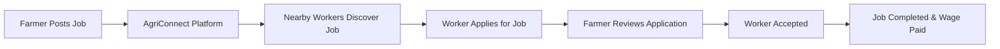
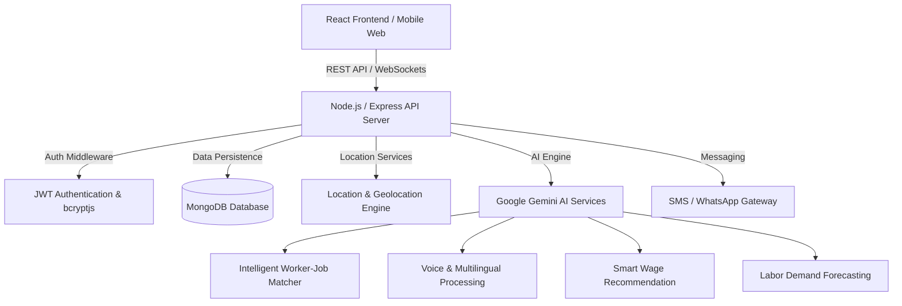

# 🌾 AgriConnect

**Connecting Farmers With the Right Workers**

[](https://github.com/vishal-s-sollapure/AgriConnect)
[](https://react.dev/)
[](https://vitejs.dev/)
[](https://nodejs.org/)
[](https://expressjs.com/)
[](https://www.mongodb.com/)
[](https://opensource.org/licenses/ISC)

AgriConnect is a technology platform designed to directly connect farmers with local agricultural workers across India. By enabling farmers to post time-sensitive farm jobs and allowing workers to discover nearby daily-wage employment opportunities, AgriConnect bridges the gap in rural agricultural labor management. The platform aims to reduce labor search friction, ensure fair wages, and empower farming communities through accessible digital technology.

---

## 📌 Table of Contents

- [About the Project](#-about-the-project)
- [Problem Statement](#-problem-statement)
- [Our Solution](#-our-solution)
- [Features](#-features)
  - [Currently Implemented](#-currently-implemented)
  - [Planned / Upcoming](#-planned--upcoming)
- [Screenshots](#-screenshots)
- [Tech Stack](#-tech-stack)
- [Architecture](#-architecture)
- [Project Structure](#-project-structure)
- [Getting Started](#-getting-started)
  - [Prerequisites](#prerequisites)
  - [Clone Repository](#clone-repository)
  - [Install & Run](#install--run)
- [Environment Variables](#-environment-variables)
- [Usage](#-usage)
- [Roadmap](#-roadmap)
- [Future AI Capabilities](#-future-ai-capabilities)
- [Security](#-security)
- [Social Impact](#-social-impact)
- [Testing](#-testing)
- [Contributing](#-contributing)
- [License](#-license)
- [Author](#-author)

---

## 🎯 About the Project

**AgriConnect** is designed specifically for the agricultural ecosystem in India. Farming operations such as crop harvesting, sowing, weeding, and paddy preparation are highly seasonal and time-critical. Delays in obtaining workers can lead to severe crop losses for farmers, while workers frequently struggle to find consistent, nearby employment with fair daily wages.

AgriConnect provides a dual-sided platform tailored for both **Farmers** and **Agricultural Workers**:
- **For Farmers:** Fast, straightforward job creation specifying crop type, worker requirements, location, daily wage rate, and duration, alongside real-time application management.
- **For Workers:** Instant discovery of nearby agricultural opportunities, transparent wage details, clear crop requirements, and one-click job application.
- **Long-term Vision:** To create an intelligent, voice-first, multilingual agricultural labor network that uses AI-driven location matching, wage estimation, and labor demand prediction to uplift rural livelihoods.

---

## 🚜 Problem Statement

Agricultural labor allocation in India relies heavily on informal, fragmented channels and word-of-mouth recommendations, creating inefficiencies for both sides:

### Farmers
- **Seasonal Labor Shortages:** Difficulty securing farm hands during peak harvesting or planting windows.
- **Time-Sensitive Risk:** Crop damage or quality degradation when harvesting is delayed due to worker unavailability.
- **Skill Alignment:** Difficulty finding workers experienced with specific crops (e.g., wheat bundling, cotton picking, paddy channel irrigation).
- **Lack of Transparency:** Variable wage expectations and labor availability uncertainties.

### Workers
- **Limited Job Visibility:** Inability to find farm work opportunities outside their immediate village or personal network.
- **Inconsistent Employment:** Unpredictable daily wage income due to lack of a centralized platform.
- **Distance & Mobility Constraints:** Difficulty finding work close to their place of residence.
- **Exploitative Middlemen:** Loss of income to unorganized agents and brokers.

---

## 💡 Our Solution

AgriConnect creates a direct, location-aware digital marketplace connecting farmers directly with nearby workers without intermediaries.

### Workflow Overview



1. **Job Posting:** Farmers post farm job listings with crop specifications, daily wage rate, and worker headcounts.
2. **Job Discovery:** Workers view available nearby jobs sorted by distance, daily wage, and crop type.
3. **Application:** Workers submit job applications directly through the platform.
4. **Management:** Farmers review incoming worker applications and update statuses (Accepted / Rejected).
5. **Direct Connection:** Accepted workers connect directly with farmers to complete agricultural tasks.

---

## ✨ Features

### ✅ Currently Implemented

The current codebase features a fully functional frontend user interface with state-driven mockup data alongside a Node.js/Express REST backend server:

- **Modern Responsive Web Interface:** Built with React 18, Vite, and custom CSS design system optimized for mobile and desktop screens.
- **Dual-Role View Switching:** Instant toggle between **Farmer** and **Worker** user perspectives.
- **Interactive Landing Page:** Features hero overview, role selector, core benefit highlights, platform metrics preview, and social impact summary.
- **Farmer Dashboard:**
  - View active farm job listings posted by the farmer.
  - Track metrics (active jobs, total workers hired, pending applications).
  - Review incoming worker applications with applicant experience, skills, and contact details.
  - Accept or reject worker applications dynamically.
- **Worker Dashboard:**
  - Browse active agricultural job listings (e.g., Wheat Harvesting, Cotton Picking, Paddy Field Prep).
  - Search and filter jobs by crop type and location.
  - Apply for jobs with instant application status updates (Pending / Accepted).
- **Interactive Post Job Modal:** Form interface for farmers to input job title, crop, daily wage (₹), workers required, location/distance, duration, and job description.
- **Simulated Auth & Profile System:** Interactive Login/Register modal for Farmers and Workers backed by React Context and `localStorage` session state.
- **Floating AI Assistant Layer (Widget):**
  - Interactive voice and multilingual AI assistant component.
  - Voice simulation trigger with prompt samples.
  - Multilingual support preview for **Kannada (ಕನ್ನಡ)**, **Hindi (हिंदी)**, **Gujarati (ગુજરાતી)**, **Tamil (தமிழ்)**, **Telugu (తెలుగు)**, **Marathi (मराठी)**, and **English**.
- **Node.js & Express API Server:**
  - REST API structure with root health check endpoint (`GET /`).
  - `/api/ai/recommendations` POST endpoint for job-worker matching calculation.
  - `/api/ai/voice-assistant` POST endpoint for intent parsing.
- **MongoDB Database Setup:** Mongoose database connection module configured for MongoDB integration.
- **Rule-Based AI Match & Intent Engine:** Heuristic algorithm calculating match scores based on crop skills, proximity, and wage benchmarks, alongside keyword intent parsing.

### 🚀 Planned / Upcoming

The following features are scheduled for future development phases:

- **JWT User Authentication:** Server-side user registration, password hashing (`bcryptjs`), and JSON Web Token authorization.
- **Database Persistence:** Full Mongoose MongoDB models (`User`, `Job`, `Application`) replacing client state memory.
- **Real-Time GPS & Map Integration:** Live geolocation positioning, distance radius calculations, and interactive map displays (Leaflet / Google Maps).
- **Web Speech API & Audio Integration:** Native browser speech-to-text recording and voice response synthesis.
- **Google Gemini API Integration:** Generative AI engine for voice query understanding, real-time dialect translation, and natural conversational responses.
- **SMS & WhatsApp Notifications:** Instant SMS alert gateway (Twilio / WhatsApp Business API) notifying workers and farmers of job applications and acceptances in local languages.
- **Rating & Reputation System:** Dual-rating system for farmers and workers to build community trust and safety.
- **Smart Wage Recommendation Engine:** ML model predicting fair daily wage rates based on crop demand, season, region, and job duration.
- **Labor Demand Forecasting:** Predictive analytics dashboard estimating seasonal labor shortages for regional agricultural planning.

---

## 📸 Screenshots

<!-- Add screenshots here -->

*Screenshots will be added as UI design iterations are finalized.*

### Recommended Future Showcase Views:
- **Landing Page & Role Selection**
- **Farmer Dashboard & Application Management**
- **Worker Job Discovery & Application View**
- **Post Agricultural Job Modal**
- **Multilingual & Voice AI Assistant Interface**
- **Mobile Responsive View**

---

## 🛠️ Tech Stack

### Currently Installed & Implemented

| Layer | Technology | Purpose |
|---|---|---|
| **Frontend** | React 18 | Declarative UI component hierarchy |
| **Build Tool** | Vite 5 | Fast development server and production bundling |
| **Icons** | Lucide React | Modern vector icon set |
| **Styling** | Custom Vanilla CSS | Responsive design system and glassmorphism styling |
| **Backend Runtime** | Node.js | JavaScript runtime environment |
| **Web Framework** | Express.js 5 | REST API routing and middleware management |
| **Database ODM** | Mongoose 9 | MongoDB object modeling and database connection |
| **Development Utilities** | Nodemon & Concurrently | Server hot reloading and monorepo script execution |

### Planned Technologies (Upcoming Phases)

| Technology | Planned Purpose |
|---|---|
| **Tailwind CSS** | Utility-first styling framework |
| **JWT & bcryptjs** | Secure user authentication and password encryption |
| **Google Gemini API** | Advanced LLM intelligence for voice and multilingual support |
| **Web Speech API** | Native speech recognition and audio synthesis |
| **Leaflet / Google Maps API** | Geolocation mapping and interactive job discovery maps |
| **Twilio API** | SMS and WhatsApp notifications in regional languages |

---

## 🏗️ Architecture

### Current Implementation Architecture

AgriConnect currently operates as a decoupled client-server architecture:
- **Client:** React 18 single-page application utilizing `AgriContext` for centralized application state (Jobs, Applications, User Session) and component rendering.
- **Server:** Node.js Express server providing health checks and AI helper endpoints (`/api/ai/recommendations`, `/api/ai/voice-assistant`) with Mongoose database configuration.

```mermaid
graph TD
    User[User: Farmer / Worker] -->|Browser Interaction| ReactApp[React 18 Frontend - Vite]
    ReactApp -->|State Management| Context[AgriContext - Local State & LocalStorage]
    ReactApp -->|HTTP REST Requests| ExpressServer[Node.js / Express Server]
    ExpressServer -->|Routes| AIRoutes[/api/ai Routes]
    AIRoutes -->|Controllers| AIController[AI Controller]
    AIController -->|Service| AIService[AI Service Heuristics]
    ExpressServer -->|Database Config| MongoDB[(MongoDB Database)]
```

### Planned Full-Stack Architecture



---

## 📂 Project Structure

```
AgriConnect/
├── client/                               # React Frontend Application
│   ├── src/
│   │   ├── assets/                       # Static assets and media
│   │   ├── components/
│   │   │   ├── common/
│   │   │   │   ├── AIAssistantWidget.jsx # Multilingual & Voice AI Widget
│   │   │   │   ├── Footer.jsx            # Application Footer component
│   │   │   │   └── Navbar.jsx            # Main Navigation bar component
│   │   │   ├── farmer/
│   │   │   │   └── PostJobModal.jsx      # Job Creation modal component
│   │   │   ├── jobs/                     # Job listing components (future)
│   │   │   └── worker/                   # Worker specific components (future)
│   │   ├── context/
│   │   │   └── AgriContext.jsx           # React Context for Jobs, Apps & State
│   │   ├── pages/
│   │   │   ├── auth/
│   │   │   │   └── AuthModal.jsx         # Login & Registration modal
│   │   │   ├── farmer/
│   │   │   │   └── FarmerDashboard.jsx   # Farmer control panel & application manager
│   │   │   ├── public/
│   │   │   │   └── LandingPage.jsx       # Public landing & feature showcase page
│   │   │   └── worker/
│   │   │       └── WorkerDashboard.jsx   # Worker job discovery panel
│   │   ├── services/
│   │   │   └── api.js                    # API service handler for backend calls
│   │   ├── App.jsx                       # Root application component
│   │   ├── index.css                     # Global CSS styling & design system
│   │   └── main.jsx                      # Vite application entry point
│   ├── index.html                        # HTML entry point
│   ├── package.json                      # Client dependencies & scripts
│   └── vite.config.js                    # Vite server configuration
├── server/                               # Node.js Express Backend Server
│   ├── config/
│   │   └── db.js                         # Mongoose MongoDB connection config
│   ├── controllers/
│   │   └── aiController.js               # AI feature controller handlers
│   ├── middleware/                       # Express middlewares (future auth/error)
│   ├── models/                           # Mongoose data models (future)
│   ├── routes/
│   │   └── aiRoutes.js                   # AI API endpoint routes
│   ├── services/
│   │   └── aiService.js                  # AI matching & intent parsing logic
│   ├── .env                              # Backend environment variables
│   ├── package.json                      # Server dependencies & scripts
│   └── server.js                         # Express application entry point
├── package.json                          # Monorepo root scripts
└── README.md                             # Project documentation
```

---

## ⚙️ Getting Started

Follow these instructions to set up and run AgriConnect on your local environment.

### Prerequisites

Ensure you have the following installed on your machine:
- **Node.js**: v18.0.0 or higher ([Download Node.js](https://nodejs.org/))
- **npm**: v9.0.0 or higher (comes bundled with Node.js)
- **MongoDB**: (Optional for server DB connection; local instance or MongoDB Atlas connection string)

### Clone Repository

```bash
git clone YOUR_REPOSITORY_URL
cd AgriConnect
```

### Install & Run

#### Option 1: Monorepo Combined Execution (Recommended)

Run both client and server simultaneously using the root scripts:

```bash
# Install dependencies for both client and server
npm run install:all

# Launch both server and client concurrently
npm run dev
```

The application will be accessible at:
- **Frontend App:** `http://localhost:5173`
- **Backend API:** `http://localhost:5000`

#### Option 2: Separate Terminal Execution

**Terminal 1 — Backend Server:**
```bash
cd server
npm install
npm run dev
```

**Terminal 2 — Frontend Client:**
```bash
cd client
npm install
npm run dev
```

---

## 🔐 Environment Variables

The backend server relies on configuration variables defined in `server/.env`.

### Example Server Environment File (`server/.env`)

```env
# Server Port
PORT=5000

# Node Environment
NODE_ENV=development

# MongoDB Connection String
MONGO_URI=mongodb://localhost:27017/agriconnect

# JWT Secret (for upcoming authentication phase)
JWT_SECRET=your_jwt_secret_key_here
```

> [!NOTE]  
> Do not commit real secret keys, database credentials, or API tokens to version control. The above values are placeholders for local development.

---

## 🚀 Usage

### 1. Public Landing Page & Platform Overview
Open `http://localhost:5173` in your web browser. Explore the core mission, platform features, worker/farmer benefits, and live metrics preview.

### 2. View Switching & Authentication Simulation
- Click **"Farmer Portal"** or **"Worker Portal"** in the navigation header to switch role perspectives.
- Click **"Login"** or **"Get Started"** to open the interactive authentication modal, simulating account creation for both Farmers and Workers.

### 3. Farmer Workflow
1. Switch to the **Farmer Dashboard**.
2. Click **"+ Post New Job"** to launch the job creation modal.
3. Enter job parameters: Title (e.g. *Wheat Harvesting*), Crop type, Daily wage (e.g. *₹650/day*), Workers needed, Location, and Duration.
4. Submit the form to add the job listing dynamically.
5. Review applicant cards under **"Received Worker Applications"** and click **"Accept Application"** or **"Reject"**.

### 4. Worker Workflow
1. Switch to the **Worker Dashboard**.
2. Search and filter available farm jobs by location or crop name.
3. Review job details including daily wage, distance, crop, and total workers needed.
4. Click **"Apply Now"** to submit an application.
5. Track application status changes (*Pending* → *Accepted*).

### 5. Multilingual & Voice AI Assistant
1. Click the floating **AgriConnect AI** badge at the bottom-right corner.
2. Select your preferred language (e.g., **Kannada**, **Hindi**, **Gujarati**, **English**).
3. Click the microphone icon to test the simulated voice recognition prompt engine.

---

## 🗺️ Roadmap

```
PHASE 1 ✅ Landing Page
        ↓
PHASE 2 ✅ Authentication + User Profiles (Completed)
        ↓
PHASE 3 ✅ Farmer Job Posting (Completed)
        ↓
PHASE 4 ⏳ Worker Job Discovery + Applications
        ↓
PHASE 5 ⏳ Location / Nearby Jobs
        ↓
PHASE 6 ⏳ AI Matching
        ↓
PHASE 7 ⏳ Voice + Multilingual + Smart Features
```

### Phase 1 — Landing Page ✅
- [x] Responsive design system & modern hero section
- [x] Dual-role preview switcher (Farmer & Worker views)
- [x] Feature highlights & impact statistics

### Phase 2 — Authentication + User Profiles ✅ (Completed)
- [x] Authentication
- [x] Farmer registration
- [x] Worker registration
- [x] JWT authentication
- [x] Role-based access
- [x] User profiles
- [x] Farmer dashboard foundation
- [x] Worker dashboard foundation

### Phase 3 — Farmer Job Posting ✅ (Completed)
- [x] Job Mongoose Schema & REST API endpoints (`/api/jobs`)
- [x] Farmer Job creation modal and active job management dashboard
- [x] Job listing cancellation and worker headcount tracking

### Phase 4 — Worker Job Discovery + Applications
- [ ] Job Application Mongoose Schema & REST API endpoints (`/api/applications`)
- [ ] Worker job discovery feed with crop & location search filtering
- [ ] Worker application submission & Farmer acceptance workflow

### Phase 5 — Location / Nearby Jobs
- [ ] Browser Geolocation API positioning
- [ ] Distance calculation algorithms & radius filtering
- [ ] Interactive Map interface (Leaflet / Google Maps integration)

### Phase 6 — AI Matching
- [ ] ML worker-job match score algorithm
- [ ] Automated crop skill alignment & daily wage parity scoring

### Phase 7 — Voice + Multilingual + Smart Features
- [ ] Web Speech API real-time voice input & text-to-speech engine
- [ ] Google Gemini API integration for LLM queries & dialect translation
- [ ] Smart wage recommendation engine & labor demand forecasting

---

## 🤖 Future AI Capabilities

AgriConnect is designed to evolve into an AI-powered agricultural labor ecosystem.

```
AI Engine Roadmap:
├── AI Worker Matching
├── Voice Job Posting
├── Multilingual Dialect Translation
├── Smart Wage Recommendation
└── Labor Demand Prediction
```

### 1. AI Worker-Job Matching
Evaluates multiple parameters to recommend the best worker-job matches:
- **Proximity:** Distance between farm location and worker residence.
- **Crop Expertise:** Worker's past experience with specific crops (e.g., Paddy, Cotton, Wheat).
- **Daily Wage Parity:** Alignment between farmer's wage offer and worker expectations.
- **Availability & Ratings:** Worker availability schedule and historical community ratings.

*Example Output:*
- Worker A (Wheat Harvesting, 2.5 km away) → **95% Match**
- Worker B (Cotton Picking, 4.0 km away) → **88% Match**

### 2. Voice Job Posting
Enables farmers to post complete job listings using natural spoken language:
1. Farmer speaks into phone microphone: *"I need 5 workers for wheat harvesting in Anand for 3 days at 650 rupees per day."*
2. Speech-to-Text converts audio stream.
3. Natural Language Entity Extraction identifies crop (`Wheat`), workers needed (`5`), location (`Anand`), duration (`3 Days`), and wage (`₹650/day`).
4. Job posting form auto-populates for farmer confirmation.

### 3. Multilingual Support
Native support for major regional agricultural languages including **Kannada (ಕನ್ನಡ)**, **Hindi (हिंदी)**, **Gujarati (ગુજરાતી)**, **Tamil (தமிழ்)**, **Telugu (తెలుగు)**, **Marathi (मराठी)**, and **English**.

### 4. Smart Wage Recommendation
Analyzes regional labor market conditions, crop urgency, seasonal trends, and task difficulty to recommend fair daily wage rates to farmers, ensuring competitive compensation and fast hiring.

### 5. Labor Demand Prediction
Utilizes historical harvest cycles, regional crop sowing data, and weather patterns to forecast labor shortages before peak harvesting seasons, alerting agricultural cooperatives and worker groups in advance.

---

## 🔒 Security

### Currently Implemented
- **Environment Variable Isolation:** Sensitive configurations (`PORT`, `MONGO_URI`, `JWT_SECRET`) stored strictly in `.env` files.
- **CORS Middleware:** Configured on the Express backend to prevent unauthorized cross-origin access.
- **Body Sanitization:** Express JSON parsing limits payload sizes.

### Planned Security Infrastructure
- **Password Hashing:** Salting and hashing passwords using `bcryptjs` before storage.
- **Stateless Auth:** Secure HTTP-only cookies and Bearer JWT tokens.
- **Rate Limiting:** Express rate limiting to prevent API abuse and brute-force attacks.
- **Input Validation:** Schema validation middleware for all API request bodies.

---

## 🌱 Social Impact

AgriConnect addresses key United Nations Sustainable Development Goals (SDGs), including **SDG 1 (No Poverty)**, **SDG 8 (Decent Work and Economic Growth)**, and **SDG 9 (Industry, Innovation, and Infrastructure)**:

- **Empowering Farmers:** Prevents catastrophic harvest losses by accelerating worker discovery during critical crop cycles.
- **Uplifting Daily Wage Workers:** Provides transparent, consistent, and dignified employment opportunities close to home.
- **Eliminating Exploitation:** Bypasses middlemen fees, ensuring 100% of agreed daily wages reach agricultural workers directly.
- **Digital Inclusion:** Brings modern digital tools to rural farming communities through intuitive UI and voice-first interfaces.

---

## 🧪 Testing

Testing infrastructure will be added as the project evolves. Automated unit tests (Jest/React Testing Library) and API integration tests (Supertest) are planned for Phase 2.

---

## 🤝 Contributing

Contributions are welcome! Follow these steps to contribute:

1. **Fork** the repository.
2. **Create** a feature branch: `git checkout -b feature/AmazingFeature`
3. **Commit** your changes: `git commit -m 'Add some AmazingFeature'`
4. **Test** your changes locally.
5. **Push** to the branch: `git push origin feature/AmazingFeature`
6. **Open** a Pull Request describing your changes.

---

## 📄 License

This project is licensed under the **ISC License** as specified in `server/package.json`.

---

## 👨‍💻 Author

**Vishal S Sollapure**  
- GitHub: [vishal-s-sollapure](https://github.com/vishal-s-sollapure)  
- Project: AgriConnect — Connecting Farmers With the Right Workers
