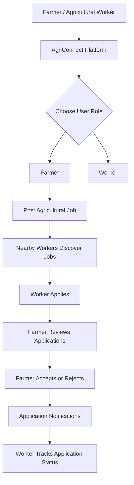
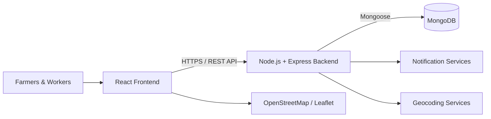

# 🌾 AgriConnect
### Connecting Farmers with Agricultural Workers | Building a More Accessible Rural Employment Ecosystem

<p align="center">
  <strong>A technology-driven agricultural labor marketplace designed to bridge the gap between farmers seeking reliable workers and rural workers seeking employment.</strong>
</p>

<p align="center">
  <a href="https://agri-connect-gamma-kohl.vercel.app/"><strong>🚀 Live Application</strong></a> •
  <a href="https://agriconnect-jc13.onrender.com"><strong>⚙️ Backend API</strong></a> •
  <a href="https://github.com/vishal-s-sollapure/AgriConnect"><strong>💻 GitHub Repository</strong></a>
</p>

<p align="center">
  
  
  
  
  
  
</p>

---

## 🌱 The Problem We're Solving

Agriculture depends on timing. During sowing, transplanting, weeding and harvesting seasons, farmers often need additional workers within a limited period.

But finding the right workers is not always easy.

In many rural communities, agricultural employment still depends heavily on personal contacts, word-of-mouth communication and local intermediaries.

This creates challenges on both sides:

**For farmers**
- Difficulty finding available agricultural workers during peak farming seasons.
- Delays in arranging workers for time-sensitive agricultural operations.
- Limited visibility into workers' skills, availability and location.
- Uncertainty around wage expectations and hiring coordination.

**For agricultural workers**
- Limited access to nearby employment opportunities.
- Dependence on informal networks to discover available work.
- Difficulty comparing wages, work requirements and locations.
- Lack of a convenient way to apply and track employment opportunities.

### 💡 Our Solution: AgriConnect

AgriConnect is a dual-sided digital agricultural labor marketplace that brings farmers and agricultural workers onto one platform.

Farmers can publish agricultural job opportunities with transparent work details and wage information. Workers can discover nearby jobs, compare opportunities, apply directly and track their application status.

**Our goal is simple: make agricultural employment discovery more accessible, transparent and efficient.**

---

## 🚀 Live Project

| Component | Link |
|---|---|
| 🌐 Frontend Application | [https://agri-connect-gamma-kohl.vercel.app/](https://agri-connect-gamma-kohl.vercel.app/) |
| ⚙️ Backend API | [https://agriconnect-jc13.onrender.com](https://agriconnect-jc13.onrender.com) |
| 💻 GitHub Repository | [AgriConnect – Source Code](https://github.com/vishal-s-sollapure/AgriConnect) |

*The frontend is hosted on Vercel and the backend API is hosted on Render.*

---

## 👥 How AgriConnect Works



### 👨‍🌾 For Farmers
1. Create an account as a farmer.
2. Publish agricultural job opportunities.
3. Specify crop, work type, number of workers, wages, duration and farm location.
4. Review incoming applications.
5. Accept or reject applicants and manage hiring capacity.

### 👷 For Agricultural Workers
1. Register as a worker.
2. Explore available agricultural jobs.
3. Filter opportunities by crop, work type, location and wages.
4. Check approximate distance to job locations.
5. Apply for suitable opportunities.
6. Track application status and receive notifications.

---

## ✨ Key Features

### 1. Agricultural Job Marketplace
- Dedicated farmer and worker experiences.
- Create, edit, close, reopen and manage job listings.
- Job details include crop, work type, wages, duration and required workforce.
- Public job discovery with search and filtering.

### 2. Location-Based Job Discovery
- Interactive maps using Leaflet and OpenStreetMap.
- Location-based job discovery and distance sorting.
- Haversine formula for calculating geographical distance.
- GPS-assisted farm location selection.
- List, map and split-view browsing experiences.

### 3. Application & Hiring Management
- Direct worker applications.
- Farmer-side applicant management.
- Application statuses: Pending, Accepted, Rejected and Withdrawn.
- Duplicate application prevention.
- Hiring capacity enforcement.
- Privacy-conscious contact disclosure.

### 4. Smart Recommendations & Agricultural Assistance
- Rule-based worker-job compatibility scoring.
- Skill and location-based matching.
- Seasonal crop and agricultural planning assistance.
- Wage estimation based on agricultural work information.
- Voice-assisted search with text-input fallback.

### 5. Multilingual Accessibility
Seven supported languages:

- English
- Kannada
- Hindi
- Gujarati
- Marathi
- Tamil
- Telugu

Designed to make the platform more accessible to users from different linguistic backgrounds.

### 6. Notification System
- New application notifications.
- Application acceptance and rejection updates.
- Application withdrawal notifications.
- Job update and closure notifications.
- Unread notification tracking.
- User-specific notification management.

### 7. Responsive Design & Accessibility
- Responsive layouts for mobile and desktop.
- Accessible navigation and dialog interactions.
- Keyboard navigation support.
- Screen-reader-oriented labels and announcements.
- Reduced-motion support.

---

## 🛠️ Technology Stack

| Category | Technologies |
|---|---|
| Frontend | React 18, Vite |
| Routing | React Router |
| Styling | CSS, Responsive Design |
| Backend | Node.js, Express.js |
| Database | MongoDB, Mongoose |
| Authentication | JWT, bcryptjs |
| Maps | Leaflet, React-Leaflet, OpenStreetMap |
| API Communication | Axios, Fetch API |
| Localization | Multilingual translation system |
| Version Control | Git, GitHub |
| Frontend Hosting | Vercel |
| Backend Hosting | Render |

---

## 🏗️ System Architecture



**Architecture overview:**

- React provides the user-facing application.
- Express handles API requests and application logic.
- MongoDB stores users, jobs, applications and notifications.
- JWT protects authenticated endpoints.
- Location services support geographical job discovery.
- The notification service manages application and job lifecycle events.

---

## 📈 Development Journey – 9 Phases Completed

AgriConnect was developed incrementally, with each phase introducing and validating a major part of the platform.

| Phase | Development Milestone | Status |
|---|---|---|
| 1 | Landing Page & Design System | ✅ Completed |
| 2 | Authentication & Role-Based Profiles | ✅ Completed |
| 3 | Farmer Job Posting & Management | ✅ Completed |
| 4 | Worker Job Discovery & Applications | ✅ Completed |
| 5 | Applicant Management & Hiring | ✅ Completed |
| 6 | Location-Based Matching & Interactive Maps | ✅ Completed |
| 7 | Smart Recommendations & Agricultural Assistance | ✅ Completed |
| 8 | Multilingual Support & Accessibility | 🟡 Manual Sign-off Pending |
| 9 | Notifications & Event Messaging | ✅ Completed |

**Development milestone:** All nine phases have been implemented and pushed to GitHub. Automated tests have been reported as passing.

### Phase 8 – Remaining Verification

Three manual verification activities remain:

1. Native-speaker review of Gujarati, Marathi, Tamil and Telugu, plus Kannada and Hindi spot-checks.
2. Screen-reader testing using NVDA or Windows Narrator and Android TalkBack.
3. Keyboard navigation across Chrome, Edge and Firefox, and mobile layout verification at 360px, especially in Tamil and Telugu.

These checks will be marked complete only after actual human and device verification.

---

## 🧪 Testing & Quality Assurance

The project includes automated tests for important application functionality.

Areas covered include:

- Authentication, authorization and user roles.
- Farmer job creation and management.
- Worker job discovery and applications.
- Hiring capacity and application privacy.
- Location matching and distance calculations.
- Recommendation and agricultural planning logic.
- Translation dictionary integrity.
- Notification creation and lifecycle management.

### Run Tests Locally

```bash
# Client translation integrity tests
npm run test:i18n --prefix AgriConnect/client

# Client production build
npm run build --prefix AgriConnect/client

# Backend test suite
npm test --prefix AgriConnect/server
```

---

## 💻 Run AgriConnect Locally

### Prerequisites
- Node.js v20 or higher.
- npm v10 or higher.
- MongoDB local installation or MongoDB Atlas account.
- Git.

### 1. Clone the repository

```bash
git clone https://github.com/vishal-s-sollapure/AgriConnect.git
cd AgriConnect
```

### 2. Install dependencies

```bash
npm run install:all
```

### 3. Configure environment variables

Configure the backend environment in:

`AgriConnect/server/.env`

Configure the frontend environment if required in:

`AgriConnect/client/.env`

Use the provided `.env.example` files as templates.

### 4. Start the application

```bash
npm run dev
```

Local development URLs:

- Frontend: `http://localhost:5173`
- Backend: `http://localhost:5000`

---

## 🔐 Environment Variables

### Backend

| Variable | Purpose |
|---|---|
| `PORT` | Backend server port |
| `NODE_ENV` | Application environment |
| `MONGODB_URI` | MongoDB connection string |
| `JWT_SECRET` | JWT signing secret |
| `CLIENT_URL` | Allowed frontend origin for CORS |

### Frontend

| Variable | Purpose |
|---|---|
| `VITE_API_BASE_URL` | Backend API base URL |

**Security:** Never commit `.env` files, database credentials, JWT secrets or private API keys to GitHub.

---

## 🔮 Future Enhancements

AgriConnect provides a foundation for further agricultural technology development.

Potential future improvements include:

- **SMS & WhatsApp Integration:** Job alerts for workers with limited internet access.
- **Offline-First PWA:** Better usability in rural areas with unstable connectivity.
- **Advanced Wage Intelligence:** Data-driven regional wage recommendations.
- **Digital Payments:** Secure and transparent wage payment integration.
- **Verified Profiles:** Additional identity and agricultural experience verification.
- **Regional Expansion:** More Indian languages and region-specific agricultural workflows.

---

## 🎯 Real-World Impact & Vision

AgriConnect is designed around a practical challenge faced by agricultural communities: connecting people who need agricultural work with people who need agricultural workers.

By bringing job discovery, wage information, location-based matching and application management into one platform, the project aims to:

- Reduce friction in finding agricultural employment.
- Help farmers reach a wider pool of potential workers.
- Improve visibility into available work opportunities.
- Encourage more transparent communication around wages and work requirements.
- Make digital agricultural services more accessible through regional languages.

**AgriConnect is more than a job listing application. It is an attempt to apply technology to a real-world rural employment challenge.**

---

## 👨‍💻 About the Developer

**Vishal S Sollapure**

B.E. Computer Science & Engineering (AI & ML) Student | AI & Software Developer

I enjoy building practical software solutions that combine technology with real-world problem solving, particularly in AI, full-stack development and socially relevant applications.

AgriConnect represents my effort to understand a real-world problem, design a full-stack solution, and develop it through an iterative engineering process.

- GitHub: [vishal-s-sollapure](https://github.com/vishal-s-sollapure)
- Project Repository: [AgriConnect](https://github.com/vishal-s-sollapure/AgriConnect)
- Live Application: [Try AgriConnect](https://agri-connect-gamma-kohl.vercel.app/)

---

## 🤝 Contributions

Suggestions, feedback and contributions are welcome.

1. Fork the repository.
2. Create a feature branch.
3. Make your changes.
4. Run relevant tests.
5. Submit a pull request with a clear description.

---

## 📄 License

This project is licensed under the ISC License.

---

<p align="center">
  <strong>🌾 Building connections. Empowering workers. Supporting Indian agriculture.</strong>
</p>

<p align="center">
  Made with ❤️ by <strong>Vishal S Sollapure</strong>
</p>
